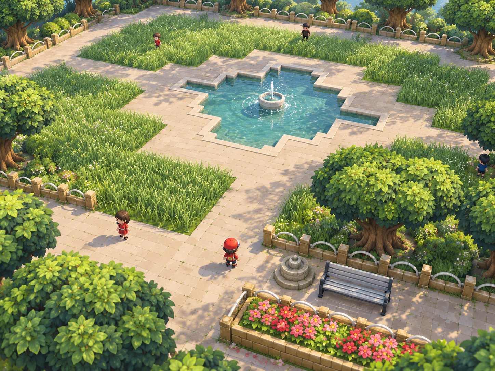

# National Park remake reference

Generated with the built-in imagegen tool on 2026-10-11 at the user's request. The user explicitly directed that this image become a reference for the active outdoor rendering goal, and specifically requested the distinctive outer park trees and benches.

This is an art-direction target, not an implemented screenshot or an exact map-layout specification. Preserve authoritative source-map positions, collisions, paths, events and encounter beds during implementation. The wider concept composes the original northern pool and southern promenade together so their material and foliage treatment can be judged together.

User review: close enough to aim for; retain this render as the saved art reference. The generated centerpiece shape is incorrect. Restore the original 2D Poké Ball centerpiece silhouette and its two distinct grass types during implementation. Do not copy the concept's grass distribution or centerpiece geometry as authoritative. Use its materials, planting treatment, trees, benches and lighting as the visual-quality target.

Priorities: spreading park-tree silhouettes distinct from route trees; pale slatted benches with dark frames and full depth; warm varied stone paving and coping; real fountain spray with ripples and depth; readable, varied meadow grass; source-like hoop fences and pink/red flowerbeds; subtle contact shadows and broken canopy light. Match the detail hierarchy and restrained blending without adding clutter or moving source objects.

Inputs were temporary native captures from the ignored local Crystalpack: faithful 2D southern benches/trees at (20,40), northern plaza at (20,24), and the current wider 3D pool view at 45 degrees. These diagnostic source captures are not shipped assets.

## Exact generation prompt

Use case: stylized-concept.
Asset type: National Park outdoor art-direction reference for a modern 3D remake of Pokémon Crystal.
Create one beautifully composed, nuanced, alive, premium hand-painted 3D game render of National Park, seen from an elevated three-quarter gameplay camera at 45-degree azimuth, with enough breadth to include the park's distinctive OUTER TREES and SOUTHERN BENCHES as well as its fountain plaza. This is a remake of the supplied 2D park, not a generic fantasy park.

Input roles: image 1 is the faithful 2D SOUTHERN PLAZA reference: the unusual broad umbrella-like park trees with strong flared trunks, pale slatted benches with dark structural frames, low warm fence posts with pale hoop rails, enclosed pink/red flowerbed, small tiered masonry fountain, and path placement are important. Image 2 is a spatial reference of the current 3D NORTHERN POOL AND GRASS-BED arrangement; retain its recognizable terraced/stepped fountain-pool footprint and broad walkways, but replace its crude surfaces and flat blue center spray with tasteful finished 3D forms. Image 3 is the original 2D northern plaza reference, confirming pavement, grass beds and pool. These images show different parts of the SAME park. Synthesize a coherent wider park view with northern pool farther back and southern bench/flowerbed promenade nearer the camera. Do not imitate the bad current 3D materials.

Art direction: restrained craft and elegance, rounded but irregular broadleaf park-tree crowns with a spreading umbrella silhouette distinct from the forest-route trees; overlapping articulated leaf sprays, deep blue-green interior foliage, olive and lime sun-facing leaves, visible branching and subtly fluted warm brown trunks with rooted bases. Outer trees must be prominently visible framing both sides and the far boundary, with varied asymmetry and believable depth, not identical spherical blobs or conifers. Preserve intentional formal garden organization while avoiding rigid cloned foliage.
Warm ivory and muted buff stone paths with restrained staggered masonry, subtle wear and tonal variation, narrow fine joints, softly worn bevels, tiny grass/moss at a few grounded edges. No checkerboard pixel patterns. Grassy encounter beds should read as lush broad-bladed meadow foliage with variation in height and direction, open translucent tips and softly irregular edges; characters remain readable rather than buried in a wheat wall.
The recessed northern pool has substantial lightly weathered limestone coping following the source's stepped shape with gently chamfered corners, cool clear blue-green water with depth, sun glints, reflected leaves and concentric ripples. Its central shallow carved stone basin has an elegant small water jet with delicate arcing spray and fine droplets actually above the water; no flat bright-blue sprite squares and no enormous cathedral fountain.
Include the characteristic pale gray slatted park benches with dark charcoal frames along the southern promenade; show seat, backrest, supports and real depth. Low fenced beds contain coherent clusters of pink and red flowers, muted greenery, soil and occasional fallen petals. Keep the source's small southern tiered pedestal fountain distinct from the northern pool fountain. No invented buildings or large monuments.
Lighting: warm late-morning sun, subtle soft atmospheric perspective, cool gentle canopy shadows, finely broken dappled light across the paving and grass, strong contact grounding, quiet specular water, lively but restrained colors. Enough small life and detail to feel inhabited: the small red-capped trainer and a few park visitors at game scale, slight wind through leaf and grass tips. Natural material blending, balanced detail hierarchy, generous readable walking space.
Composition: landscape 4:3, a cohesive attractive real-time game screenshot, camera sufficiently pulled back to show trees, benches and the key park spaces together, with foliage framing rather than obscuring the park. Highest visual care. No text, captions, UI, watermark, pixel texture, voxel blocks, polygonal toy diorama, plastic ball trees, neon borders, crunchy all-over noise, excessive flowers or decorative clutter.
