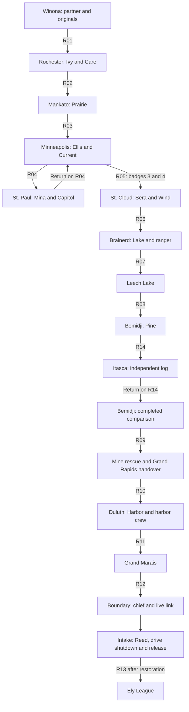

# Minnesota progression

The main journey starts in Winona, follows eight gyms to Duluth, stops Lode's
operation in Boundary Waters and ends at the Ely League. This profile describes
the authored journey. [STORY.md](STORY.md) identifies the current narrative
sources and writing conventions; [GYMS.md](GYMS.md) describes the room courses.
Use [world.json](world.json) and the Rust route builders for actual connections.
A route plan or a local chapter fixture does not prove a completed campaign.

## Main journey

The St. Paul and Itasca return trips have a purpose: the first completes the
two-city badge condition for northern travel; the second exposes the copied
surveys. The player travels back through the region. Do not replace either
return with an unexplained teleport.

## Southern towns and the Twin Cities

| Stop | Main actions | Progression contract |
| --- | --- | --- |
| Winona | Meet Mom and Tamarack; choose Pouchid, Kindlit or Birchit at level 5; collect Ivy's envelope and five Poké Balls; meet Reed | Starter receipt opens R01. Gifts remain separate, retryable actions. The Gillpup egg is optional |
| Rochester | Deliver the original readings to Ivy; learn Ellis is missing; meet Reed again; defeat Varel | Acknowledged delivery permits the first gym. Care opens R02 |
| Mankato | Defeat Torven; optionally inspect the copied-reading notebook | Prairie opens R03. The notebook cannot become a mandatory report gate |
| Minneapolis | Ask Jo about Ellis; witness Reed's recruitment; navigate ICE headquarters; disable holding power; rescue Ellis; hear his next request; defeat Avrin | Current opens R04. Winning a battle or reading an old drawer text cannot substitute for Ellis's rescue and spoken request |
| St. Paul | Confront the shipment operation and Reed; acknowledge Mina's request; defeat Brannic; return to Minneapolis | R05 checks Current and Capitol. Keep the courier's existing prerequisites separate from the gym and road gates |

Mina's acknowledged request carries the next lead in the current character
revision. The old manifest remains background; it cannot award her quest result.
The base `EVENT_MN_DISPATCH_NOTE` and related identifiers keep their exact names
for compatibility. Read the installed scripts before inferring an action from
an event's historical name.

## Lake country and the reference trip

| Stop | Main actions | Progression contract |
| --- | --- | --- |
| St. Cloud | Intervene in Sera's forced transfer; defeat Saven | Refusal leaves the intervention retryable. Wind opens R06 |
| Brainerd | Defeat Sivren; hear the ranger's conflicting report; collect the optional Surf gift | Lake opens the land journey and lake-country branches. Surf is not required to reach Bemidji |
| Leech Lake | Rest, speak to shore residents and continue north | R07/R08 use the Lake Badge condition |
| Bemidji | Learn Cut and complete Orlis's course; ask the officer for the independent reference | Pine is required for the story reading and the later Iron Range gate |
| Lake Itasca | Copy the independent field readings | Early exploration after Lake does not complete the Pine-qualified reading |
| Bemidji, return | Acknowledge the officer's comparison of the station records | Pine plus the completed report opens R09; a raw reading alone cannot do so |

The Mankato notebook supports the comparison. Missing it must not block the
report. Itasca is an independent reference across separate basins, not a water
supply for every northern story site.

## Mine, harbor and northern resolution

| Stop | Main actions | Progression contract |
| --- | --- | --- |
| Iron Range | Defeat the public foreman; navigate haulage, sump and ventilation; isolate the feed; defeat Reed; stop the drive; speak to Finn | Controls, victories, crew movement and meter handover remain separate. The empty case cannot award Finn's quest |
| Grand Rapids | Offer the recovered meter to the technician and acknowledge the log review | The depot keeps the meter; the player takes a log copy. Completed handover plus Pine opens R10 |
| Duluth | Earn Harbor; show the copied log to the harbor crew; inspect the intake plan and hear Ivy's call | All eight badges and the completed harbor signal open the northern expedition. Badge 8 alone cannot set that signal |
| Grand Marais | Rest, resupply and follow Gunflint | The local lamp repair and Ryan's Baptism River cabin are optional; neither replaces the Duluth signal |
| Boundary Waters shelter | Defeat the chief and acknowledge the live evidence link | The link opens access to the intake. Chief victory and link completion cannot restore the survey |
| Boundary intake | Defeat Reed; separately stop the local drive; watch Kettlurk reach water and the crew move clear | Restoration follows the final acknowledged crew sequence. Declining the battle or control leaves it available |
| Ely | Heal, stock up and register; defeat Fern, Flint, Veil, Halden and Casey; record the party in the Hall of Fame | Registration requires all eight badges and restoration. A blackout resets the active League run while preserving completed story and past championship records |

The free Boundary basecamp, shelter and main trail junctions remain available
without Safari admission. Catching Kettlurk, registering it in the Pokédex or
paying for an expedition cannot be a story gate. The ending prevents drainage;
it does not claim instant environmental recovery.

## Optional trips and return travel

| Destination | Authored access | Purpose and safeguard |
| --- | --- | --- |
| State Fairgrounds | Woodland side trail from R05, northwest of the metro | Optional activities, food, exhibits and battles; no ninth badge or mandatory paid activity |
| Detroit Lakes | R15 from Brainerd or R19 from Itasca after Lake | Beach, cabins and observation circuit; no substitute for the officer's report |
| Moorhead | R16 from Detroit Lakes after Lake | Red River and prairie visit; returns to the same regional circuit |
| Mille Lacs | R18 from Brainerd after Lake | Public shore and optional water exploration; Surf-only rewards cannot block the road |
| International Falls | R17 from Bemidji after Pine | Border visit and Voyageurs branch; R20 still requires all badges and the harbor signal |
| Lake Itasca, early visit | R14/R19 after Lake | Exploration before the qualified story reading; later interaction must remain available |
| Devil's Kettle | Optional North Shore branch | Kettlurk encounter is independent of mandatory restoration |

The authored Glacier Line order is Detroit Lakes–Staples–St. Cloud–St. Paul–
Winona, as listed in [glacier-line.json](transit/glacier-line.json). Preserve
each installed station's actual access and visited checks; a station name in the plan is not proof that its walking spur or
passenger service is published. Rail grants no badge, adjacent-city visit or
quest completion. See the [transit records](transit/README.md) for versioned
implementation details.

## Gates, teams and acceptance

| Connection | Required state |
| --- | --- |
| R05 / R06 | Badges 3 and 4 / badge 5 |
| R07, R08, R14, R15, R16, R18, R19 | Badge 6 |
| R09 / R17 | Badge 7 plus completed headwaters report / badge 7 |
| R10 | Badge 7 plus completed depot handover |
| R11, R12, R20 | All eight badges plus Duluth signal |
| R13 and League registration | All eight badges plus restored survey |

Recheck guards before departure and allow safe returns from unlocked areas.
Cancellation, a full bag, a loss or an unfinished conversation must not strand
the player. Use actual battle wins for victory flags and commit one-time gifts
after successful delivery.

All regional parties, gifts and visible creatures must resolve through
[story-pokemon.json](story-pokemon.json) and the active curated roster. Do not
copy the legacy species lists in base import records into current profiles.
Validate final pack learnsets, evolution levels and field permissions. A badge's
display name or a leader's type does not define its native HM permission.

The [current composition record](revisions/current-story-v01/README.md) and
[interior child record](interior-life/current-story-v01/README.md) describe their
own executed checks and fixture limits. Older chapter runbooks retain evidence
for their named versions. This cleanup performs no new gameplay verification.
An uninterrupted ordinary-party campaign, resource pacing across that campaign
and complete difficulty acceptance remain unclaimed. Level-boosted runs and
supplied late-chapter parties cannot establish those results.
