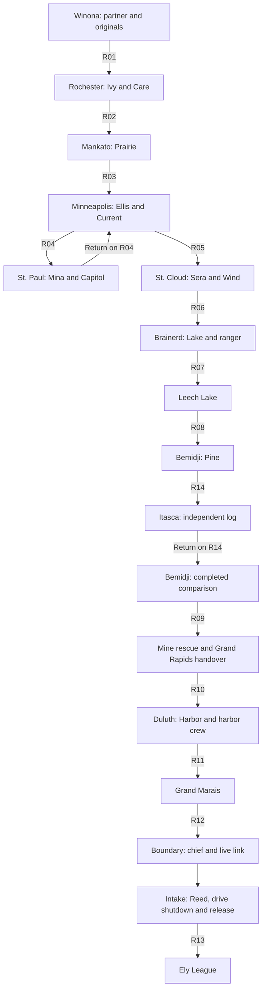

# Minnesota progression

The main journey starts in Winona, follows eight gyms to Duluth, stops Lode's
operation in Boundary Waters and ends at the Ely League. This profile describes
the authored journey. [STORY.md](STORY.md) identifies the current narrative
sources and writing conventions; [GYMS.md](GYMS.md) describes the room courses.
Use [world.json](world.json) and the Rust route builders for actual connections.
A route plan or a local chapter fixture does not prove a completed campaign.

The route below follows the story in chapter order. Public roads are open after
the starter safeguard. Badges matter at Gyms, for field skills and at League
registration. Characters can encounter evidence, including the Itasca date,
before meeting the person who would normally send them there.

## Main journey

From St. Paul, the road back through Minneapolis leads north. Returning from
Itasca lets the Bemidji officer compare the player's independent reading with
the two sheets Hale submitted.

## Southern towns and the Twin Cities

| Stop | Main actions | Progression contract |
| --- | --- | --- |
| Winona | Visit Mom, choose Pouchid, Kindlit or Birchit at level 5, and take Ivy's envelope from Tamarack. Reed challenges you at the desk. Collect five Poké Balls from the aide or on your way out. | The starter opens Route 1. The supplies remain available after a loss to Reed or a full Pack. The Loobit egg is optional. |
| Rochester | Deliver the original readings to Ivy; learn Ellis is missing; meet Reed again; defeat Varel | Acknowledged delivery permits the first gym. R02 leads to Mankato |
| Mankato | Defeat Torven; optionally inspect the copied-reading notebook | The gardener allows an early visitor to examine the optional notebook |
| Minneapolis | Ask Jo about Ellis; witness Reed's recruitment; navigate ICE headquarters; disable holding power; rescue Ellis; hear his next request; defeat Avrin | Ellis points out the broken pump ring on his way home. The player can sketch its stamp at the dispatch desk |
| St. Paul | Confront the shipment operation and Reed; acknowledge Mina's request; defeat Brannic; return to Minneapolis | The courier responds to the ring evidence. After Reed steps aside Mina immediately offers the date. A declined offer can be accepted later |

Mina's acknowledged request carries the next lead in the current character
revision. The depot timetable is distinct from the date Mina gives you.
The base `EVENT_MN_DISPATCH_NOTE` and related identifiers keep their exact names
for compatibility. Read the installed scripts before inferring an action from
an event's historical name.

## Lake country and the reference trip

| Stop | Main actions | Progression contract |
| --- | --- | --- |
| St. Cloud | Intervene in Sera's forced transfer; defeat Saven | Refusal leaves the intervention retryable. After you help, Sera walks to the square just east of the station entrance. Ask the clerk to radio Nell, then speak to Sera outside. If Finn is already safe, Sera acknowledges his rescue |
| Brainerd | Defeat Sivren; hear the ranger's conflicting report; collect the optional Surf gift | Meet the ranger on the bank beside the fishing pier. The north shore trail is walkable |
| Leech Lake | Rest, speak to shore residents and continue north | The public trail connects Brainerd and Bemidji |
| Bemidji | Learn Cut and complete Orlis's course; ask the officer for the independent reference | The officer can compare a reading brought from Itasca |
| Lake Itasca | Copy the independent field readings | At the timber footbridge, read the bank gauge or the notice on its west side. Both record the same date. After meeting the Brainerd ranger, the player recognizes her date |
| Bemidji, return | Acknowledge the officer's comparison of the station records | The officer signs the comparison with or without the Pine Badge. Bring the signed report and the badge to the public mine foreman |

The Mankato notebook supports the comparison. Missing it must not block the
report. Itasca is an independent reference across separate basins, not a water
supply for every northern story site.

## Mine, harbor and northern resolution

| Stop | Main actions | Progression contract |
| --- | --- | --- |
| Iron Range | Defeat the public foreman; navigate haulage, sump and ventilation; isolate the feed; defeat Reed; stop the drive; speak to Finn | Controls, victories, crew movement and meter handover remain separate. The empty case cannot award Finn's quest |
| Grand Rapids | Offer the recovered meter to the technician and acknowledge the log review | The depot keeps the meter; the player takes a log copy. The technician recovers the two pump times for Duluth |
| Duluth | Bring the depot times to the engineer and hear Ivy on the radio | The harbor signal follows the evidence. The player can respond immediately and earn Harbor separately |
| Grand Marais | Rest, resupply and follow Gunflint | The local lamp repair and Ryan's Baptism River cabin are optional; neither replaces the Duluth signal |
| Boundary Waters shelter | Confront Hale after the harbor call and read the times to the skipper | The link opens access to the intake. Chief victory and link completion cannot restore the survey |
| Boundary intake | Defeat Reed; stop the drive, close the sump and open the clean bypass; watch Kettlurk reach water and the crew move clear | Restoration follows the final acknowledged crew sequence. Declining the battle or control leaves it available |
| Ely | Heal, stock up and register; defeat Fern, Flint, Veil, Halden and Casey; record the party in the Hall of Fame | Registration requires all eight badges and restoration. With eight badges the registrar can identify the outstanding survey handoff. A blackout resets the run and preserves prior titles. Returning Champions can decline Casey’s rematch, prepare in the chamber and ask again with the same four wins. |

The free Boundary basecamp, shelter and main trail junctions remain available
without Safari admission. Catching Kettlurk, registering it in the Pokédex or
paying for an expedition cannot be a story gate. The ending prevents drainage;
it does not claim instant environmental recovery.

## Optional trips and return travel

| Destination | Authored access | Purpose and safeguard |
| --- | --- | --- |
| State Fairgrounds | Woodland side trail from R05, northwest of the metro | Optional activities, food, exhibits and battles; no ninth badge or mandatory paid activity |
| Detroit Lakes | R15 from Brainerd or R19 from Itasca | Beach, cabins and observation circuit; no substitute for the officer's report |
| Moorhead | R16 from Detroit Lakes | Red River and prairie visit; returns to the same regional circuit |
| Mille Lacs | R18 from Brainerd | Public shore and optional water exploration; Surf-only rewards cannot block the road |
| International Falls | R17 from Bemidji | Border visit and optional Voyageurs branch |
| Lake Itasca, early visit | R14/R19 | The dated readings can be found on the first visit |
| Devil's Kettle | Optional North Shore branch | Kettlurk visits after its rescue. The player may approach or leave it wild before or after the League |

The authored Glacier Line order is Detroit Lakes–Staples–St. Cloud–St. Paul–
Winona, as listed in [glacier-line.json](transit/glacier-line.json). Preserve
each installed station's actual access and visited checks; a station name in the plan is not proof that its walking spur or
passenger service is published. Rail grants no badge, adjacent-city visit or
quest completion. See the [transit records](transit/README.md) for versioned
implementation details.

## Gates, teams and acceptance

| Action | Required state |
| --- | --- |
| Take the readings from the Itasca marker | Reach the marker |
| Hear Ivy's call in Duluth | Grand Rapids technician has recovered the meter times |
| Confront Hale at the shelter | Duluth has connected Ivy and the harbor crew |
| Enter the intake | Chief defeated and live link acknowledged |
| Register for the Ely League | All eight badges and completed rescue |

Cancellation, a full bag, a loss or an unfinished conversation must not strand
the player. Use actual battle wins for victory flags and commit one-time gifts
after successful delivery.

All regional parties, gifts and visible creatures must resolve through
[story-pokemon.json](story-pokemon.json) and the active curated roster. Do not
copy the legacy species lists in base import records into current profiles.
Validate final pack learnsets, evolution levels and field permissions. A badge's
display name or a leader's type does not define its native HM permission.

The [current composition record](revisions/current-story-v01/README.md) and
[interior child record](interior-life/current-story-v01/README.md) describe their
own executed checks and fixture limits. Older chapter runbooks retain evidence
for their named versions. This cleanup performs no new gameplay verification.
An uninterrupted ordinary-party campaign, resource pacing across that campaign
and complete difficulty acceptance remain unclaimed. Level-boosted runs and
supplied late-chapter parties cannot establish those results.
