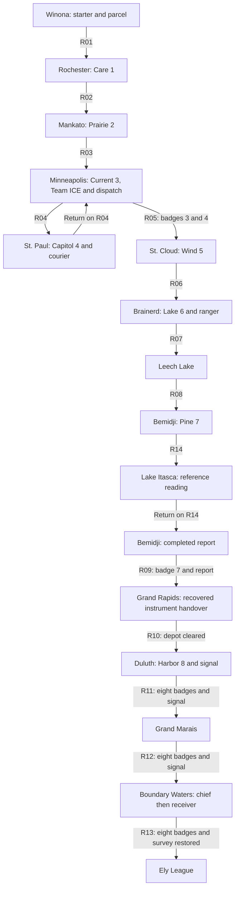

# Minnesota city by city progression

The main adventure starts in Winona, earns eight badges on the way to Duluth,
resolves the Northstar Survey in Boundary Waters and finishes at the Ely
League. This design covers all nineteen registered hubs, the Fairgrounds and
the two additional Glacier Line outposts. It preserves the route requirements
in [world.json](world.json), the milestones in [story.json](story.json) and
the [Northstar Survey story](STORY.md). Gym room and battle designs are in
[GYMS.md](GYMS.md). The connected earned journey remains implementation work.

The [current eight-gym rebuild](gyms/current-regional.md) now places the revised
physical courses in the 554-map story and 660-map compact-city branches. It
preserves these badge/departure conditions and every existing exterior/story
field. Local full-course and actual city-return checks are distinct from the
still-unearned complete regional journey described below.

The [fresh controller course](playable/minneapolis.md#new-game-through-two-badges-and-ice--2026-10-27)
earns Care, Prairie and ICE rescue/dispatch from Winona New Game on the 554-map
Ely story parent. Actual saved continuations now earn
[Current and St. Paul arrival](playable/gym-four-approach.md#earned-current-and-st-paul-arrival--2026-10-27),
then [courier victory, the separate manifest, Capitol and return](playable/courier-story.md#earned-courier-capitol-and-minneapolis-return--2026-10-27).
Captured/leveled partners, clinic recovery and Continue are real inputs. The
recorded campaign ends in Minneapolis with four badges; Wind onward remains
unproven. The later selected-gym/species relay candidate now has its own
[fresh opening and saved four-badge continuations](playable/northstar-relay.md#earned-revised-gym-campaign--2026-10-27):
Care/Prairie/ICE, Current/R04, then the courier's separate manifest, Capitol and
return to Minneapolis. Its new saves bind that exact candidate; the earlier
lineage is never relabeled. Wind onward remains open on both branches.

## Main journey

Lines show planned regional progression, not implemented walking seams. The
Minneapolis–St. Paul excursion and the Bemidji–Itasca return are intentional:
each return changes something useful. Returning from St. Paul opens the north
checkpoint; returning with the Itasca reading exposes the copied survey data.
Both use the already travelled route, its authored shortcuts and changed NPC
text. Never silently teleport the player back after the story scene.

Minneapolis's native city/ICE chapter now passes local production-controller
and stdio MCP checks: actual enforcer victory, separate captive release and
record reading, and return home. Its regional ports, Strength gift and north
checkpoint remain pending. The current integrated story/gym/cabin candidate and
remaining earned journey are recorded in [the executable runbook](playable/minneapolis.md).

## Southern departure and the Twin Cities

| Stop | What the player does | Character and local play | Departure condition |
| --- | --- | --- | --- |
| **1. Winona** | Finish the guardian scene; choose Chikorita, Cyndaquil or Totodile at level 5; collect the original readings for Rochester and five Poké Balls. | A small river town with home, field station and a short bluff/levee walk. The first meaningful choice is the partner, followed by the decision to explore Driftless side paths. Home remains a free return point. | Starter receipt opens R01. Cancellation preserves all three choices; parcel and ball rewards remain recoverable. |
| **2. Rochester** | Deliver the parcel at the clinic; learn that the matching instruments are missing; beat Varel for Care. | Clinic quarter and an approachable first gym. A ward attendant introduces status recovery. Separate the clinic delivery desk from its healing interaction so neither action hides the other. | Delivery permits the gym; badge 1 opens R02 to Mankato. |
| **3. Mankato** | Find the optional copied-reading notebook; beat Torven for Prairie. | River terraces and working prairie gardens. A steward teaches Cut after victory; a sealed optional farm cache gives the move a concrete payoff. The ordinary road stays open without it. | Badge 2 opens R03 to Minneapolis. Notebook collection is an early clue, not a hidden gate. |
| **4. Minneapolis** | Beat Avrin for Current; confront Team ICE, Lode-paid bullies posing as police; defeat their enforcer, separately release the captive dispatcher, then read the recovered dispatch copy identifying diverted instruments; inspect the north checkpoint. | Two readable districts: river powerhouse and dispatch/commercial street. ICE kidnaps people it suspects of opposition, including the dispatcher, and uses fake badges to seize records. Its enforcer remains hostile after defeat; the recovered copy links the crew to Lode. Shopping and a maintenance-desk Strength gift give a useful pause. The checkpoint names the missing Capitol Badge rather than vaguely refusing passage. | Badge 3 opens R04 to St. Paul. R05 checks badges 3 and 4; the dispatch note stages the courier at St. Paul. |
| **5. St. Paul** | Defeat Brannic for Capitol; confront and defeat the courier, then read the exposed manifest naming DEEP BORE. The gym and courier can be tackled in either order. | Civic streets, the separate steel gym, Union Depot and a north entrance to the State Fair. The courier recognizes the originals from the opening errand. Give room for the Fair after that tense scene. | Return on R04 to Minneapolis; both city badges open R05 toward St. Cloud. Courier victory independently activates the Glacier Line. |

The courier must require the actual dispatch note (`MS04`). Missing it leaves
a clear depot instruction to visit the Minneapolis dispatch desk, with return
travel available. It must not trap the player behind the courier. Do not add
the courier flag to R05's existing two-badge gate: the later report/depot
sequence remains reachable if the player postpones that confrontation. The
main mystery has a preferred order, while the current authored gate permits
this flexibility. Courier victory and rail activation can be completed later.

The Fair is a dedicated optional destination, not a ninth gym or required
collection quest. Preserve [its contract](zones/state-fairgrounds.json):
midway, livestock/4-H barns, dairy/butter exhibit, food row and show ring.
Basic access and the city return must not depend on buying food, winning a
minigame or waiting for a real calendar date. Repeatable activities need
bounded rewards and cannot duplicate one-time story items.

## Lake country and the independent reading

| Stop | What the player does | Character and local play | Departure condition |
| --- | --- | --- | --- |
| **6. St. Cloud** | Beat Saven for Wind, then prepare for the longer pine-country stretch. | Granite riverbank, windwalk gym and a compact rail district. An optional lookout surveyor offers Fly after victory; visited-place flight is an implementation requirement, not a substitute for first traversal. | Badge 5 opens R06 to Brainerd. |
| **7. Brainerd** | Beat Sivren for Lake. At the ranger station, hear the conflicting fishers' reports and claim Surf once. | The first large exploration hub: dock school, public shore and clear signposts for four directions. Make the ranger an obvious public destination. Surface witnesses show why the survey matters to ordinary residents. | Badge 6 opens R07, R15 and R18. R07 starts the main land journey toward Bemidji; the ranger gift is optional for walking it. |
| **8. Leech Lake** | Rest, speak to shore residents and continue north on land. | A shore settlement with useful walking docks and optional water encounters. This is a breathing space between gyms 6 and 7. It needs its own activity and sightline, not another full shopping district copied from Brainerd. | R08 checks badge 6. Surf is useful for side finds but never required for Bemidji. |
| **9. Bemidji, first visit** | Receive HM01 from the gym guide, teach Cut, work through Moslen and Elvren, and beat Orlis for Pine. Speak with the field officer about an independent reference at Lake Itasca. | Northwoods nursery, waterfront and field office. Signs distinguish Itasca's reference trip, the blocked Iron Range investigation and the optional border trail. | R14 already permits entry after badge 6. The story reading milestone requires badge 7; R09 requires badge 7 plus the completed report. |
| **10. Lake Itasca** | After badge 7, read the dry-land headwaters marker to record the reference. | A quiet, short landmark visit following the seventh gym: narrow crossing, readable marker and an ordinary safe way back. R19 offers the western lake loop. Do not claim this water drains into every northern story site. | Return to Bemidji with `EVENT_MN_HEADWATERS_READING`; that flag alone does not open R09. |
| **11. Bemidji, return** | Give the reference to the field officer. The comparison reveals reused readings and directs the player to the Iron Range cache. | The officer's changed dialogue rewards remembering an earlier place. Healing and resupply precede the next story dungeon. The optional Mankato notebook adds recognition but is not another required fetch. | `EVENT_MN_HEADWATERS_REPORT`, together with badge 7, opens R09. |

Brainerd's optional branches are a deliberate change in pacing after five
mostly directed gyms. Put them on a town signboard and let the player return
without consuming story resources. Optional experience helps a broader party;
the mandatory battles must still support an ordinary team without clearing
every side circuit. Before claiming balance, measure actual EXP and resources
through the existing battle-scaling policy; the authored levels below are
first-pass encounter targets, not proof of a grind-free playthrough.

## Iron Range and the northern resolution

| Stop | What the player does | Character and local play | Departure condition |
| --- | --- | --- | --- |
| **12. Grand Rapids** | Defeat the R09 foreman, separately take the meter and test log from the guarded cache, then return them at the survey depot. Learn that the tests target a powerful Water Pokémon and a northern relay controls them. | An instrument-repair and worker town, with honest residents helping expose Lode. No gym: let investigation carry this stop. The foreman's battlefield is the reserved R09 cave; the handover is in town. | MS08 records victory; MS08_CACHE records acknowledged instrument recovery. MS09 requires both, then sets `EVENT_MN_DEPOT_CLEARED` and opens R10 with badge 7. |
| **13. Duluth** | Beat Norek for Harbor; bring the depot's copied meter log to the harbor workshop receiver. It exposes the plan to drain the Boundary Waters, Kettlurk as the intended pump captive, and ICE's kidnappings. | Steep harbor districts, cold-water gym, public workshop and North Shore departure. Place a clear guide from the gym to the workshop. The eighth badge is a celebration before the final expedition. | All eight badges and `EVENT_MN_LIGHTHOUSE_SIGNAL` open R11 and R12. The signal requires the cleared depot as well as all badges. |
| **14. Grand Marais** | Recover, resupply and follow Gunflint toward the northern control relay. | Preserve the hand-authored harbor, useful pier, keeper/fisher observations and separate local lamp quest. This is a lived-in destination after the North Shore trek, not an extra mandatory badge or repair bill. Devil's Kettle remains an optional legendary branch. | R12 uses the existing eight-badge/signal gate. The local lamp repair cannot substitute for the Duluth signal or block Q07. |
| **15. Boundary Waters** | Use the free basecamp. Defeat the survey chief in the public shelter, then separately operate the receiver to send the true readings and warning. | Connected lakes, pine shores, grassy portages, campsites and Dorothy's Root Beer hospitality define the optional preserve. Keep the shelter and all regional trail junctions on free public walking access. | Chief victory opens receiver access. Confirming the receiver and completing its dialogue sets `EVENT_MN_SURVEY_RESTORED`; only then can R13 open with all eight badges. |
| **16. Ely** | Cross League Approach, heal, stock up and register for the League. Beat Fern, Flint, Veil, Reed and champion Casey; record the winning party. | A northern expedition town with a generous final rest point and clearly separate League doors. The main story has concluded, so the last challenge is battling rather than another fetch quest. | All eight badges plus survey restoration permit registration. Active League room wins advance the current run; champion completion persists. |

The chief is Magneton 44, Weezing 44 and Crobat 46; the foreman is Graveler 35,
Machoke 35 and Magneton 36; the courier is Magnemite 23 and Drowzee 22. Preserve
those [authored parties](story.json). The late chief encounter is a story
confrontation after gym 8, not another large level jump. The route back to
public care remains open before triggering it. Defeat uses ordinary blackout;
the receiver remains inoperative until an actual win. Declining receiver
activation is retryable and never marks restoration.

## Optional cities and wilderness loops

These complete the nineteen registered hubs. Their order is flexible; none
adds a required badge or mandatory side-quest completion flag.

| Place | Earliest designed access | What makes the visit worthwhile | Return and progression safeguard |
| --- | --- | --- | --- |
| **Detroit Lakes** | R15 from Brainerd after badge 6; also R19 from Itasca after badge 6. | A public beach and cabin street; the three-observation circuit pays one Max Repel (`SQ01`). Its Glacier Line station becomes a useful return destination after an actual on-foot visit. | R15 returns to Brainerd; R19 links Itasca; R16 leads to Moorhead. The observation reward is never required for the headwaters report. |
| **Moorhead** | R16 from Detroit Lakes after badge 6. | The Red River flood marker and prairie trainer circuit reward a Nugget (`SQ02`). A broad prairie/river horizon contrasts with the lake settlements. The existing depot contact can pay the reward without inventing a seventh rail stop. | Return on R16. The western state boundary is visibly closed; no unexplained travel into another region. |
| **Mille Lacs** | R18 from Brainerd after badge 6. | A three-volunteer shore-watch walk (`SQ04`), protected public docks and separate Surf-only pickups. A fishing-rod upgrade is the intended quest reward; resolve the exact base item and prior-rod behavior before lowering. | R18 is the return. All volunteers are accessible on foot; optional Surf rewards never become required quest checks. |
| **International Falls** | R17 from Bemidji after badge 7. | Border ranger check-in, colder forest edge and a later Voyageurs circuit (`SQ03`), paying one PP Up at its completed report. | R17 always returns south. R20 stays blocked until all eight badges and the Duluth signal; ranger check-in alone does not grant northern passage. |
| **Lake Itasca before badge 7** | R14 and R19 after badge 6. | Explore the crossing and observe the landscape; participate in the optional western loop. The story marker explains that the officer's assignment follows the Pine Badge. | Visiting early must not set the badge-7 reading flag, report or Iron Range access. A later interaction remains available without resetting the map. |

The full optional circuit is Brainerd → R15 → Detroit Lakes → R19 → Itasca →
R14 → Bemidji, with a Moorhead spur on R16 and Mille Lacs on R18. It can reach
Bemidji after badge 6, just as R07/R08 can. It cannot bypass Orlis or the
completed report requirement. The border alternative is Bemidji → R17 →
International Falls → R20 → Boundary Waters; it requires the same eight badges
and signal as the North Shore expedition. Both approaches meet the same
chief/receiver scene, and neither bypasses restoration at the League trail.

## Rail outposts and return travel

Preserve the [Glacier Line](transit/README.md) order: **Detroit Lakes — Staples —
St. Cloud — St. Paul — Red Wing — Winona**. Courier victory activates free
service; each destination additionally needs its own on-foot visited flag.
Passing through an unvisited station does not unlock it. A ride grants no
badge, survey event or adjacent-city discovery.

**Staples** is an optional pine-country junction reached by a walking spur
from the Brainerd side of the existing corridor after badge 6. Give it a signal
cabin, freight siding and a short useful walk to the station. **Red Wing** is
an optional river/bluff outpost on a walking spur from the already accessible
Winona side of Driftless, available after starter receipt. Its overlook climb
rewards exploration before the rail service starts. These specify first-visit
design intent; exact spur maps, ports, collisions and world registration remain
unresolved and must be added before either outpost is called connected.

Neither outpost has a gym. Keep the no-bypass rule when fitting the spurs: they
return to the same side of existing checkpoints and do not connect previously
unvisited northern hubs. Boarding, destination checks, animation and protected
arrival all use the production controller and the existing train mechanism.

## Battle pacing and return visits

| Segment | Intended team band at the main fight | What increases |
| --- | --- | --- |
| Winona → Rochester | 8–12 | One partner becomes a small usable party; basic priority and defense |
| Mankato | 13–16 | First full three-Pokémon leader; secondary typing and immunity |
| Twin Cities | 18–25 | Status, defensive types and a distinct optional-order story boss |
| St. Cloud | 26–30 | Speed, switching and screens |
| Brainerd → Bemidji | 31–40 | Branching exploration, mixed typing and recovery pressure |
| Iron Range → Duluth | 38–45 | Investigation battles, a four-Pokémon leader and stronger coverage |
| North Shore → Boundary Waters | 43–47 | Expedition endurance, useful rest stops and final story battle |
| Ely League | 47–53 | Consecutive battles and a six-Pokémon mixed champion |

Retain the authored League: Fern's Bug team 47–48; Flint's Rock team 48–49;
Veil's Ghost-themed team 49–50, including the deliberate Noctowl exception;
Reed's Dragon-themed team 50–51; Casey's Ampharos 51, Quagsire 51, Heracross 52,
Houndoom 52, Lapras 52 and Dragonite 53. The lobby offers ordinary healing,
PC and supplies before registration; no free healing is inserted between League
rooms. A blackout resets the active run, preserving badges, completed story
and past Hall of Fame entries.

After becoming champion, revisit the Fair, finish the lake/prairie/border
quests, explore optional field-move branches and use the free rail to return
home. Keep Kettlurk's Devil's Kettle encounter optional. A later gym-rematch
service should offer repeat battles and native money rewards without replaying
badges or TMs; its parties, menu, availability and balance are not yet authored.
Do not present rematches or the legendary encounter as installed content.

## Gates and proof required before publication

Keep route checks on both endpoints and recheck just before departure. Permit
return travel from unlocked areas; never strand a player after cancellation,
blackout, an unfinished reward or a receiver refusal. In particular:

- R05: badges 3 and 4; R06: badge 5.
- R07/R08 and R14/R15/R16/R18/R19: badge 6.
- R09: badge 7 and completed headwaters report; R17: badge 7.
- R10: badge 7 and cleared depot, not merely foreman victory.
- R11/R12/R20: all eight badges and the Duluth signal.
- R13 and League registration: all eight badges and restored survey.

The [connected Winona → Rochester delivery](playable/rochester.md) now passes
from native New Game through R01, acknowledgment, Continue and the return home.
Gym1's battles/reward pass separately with an explicit local partner fixture.
One New Game Cyndaquil journey with a real caught partner now earns Care and
continues over actual stdio; another live-RNG attempt blacked out at Varel.
The [prairie chapter](playable/prairie-story.md) now binds R02/Mankato and the
optional notebook with local controller, Continue and actual stdio proof.
Its local setup supplies Care and an empty party. The later
[fresh relay campaign](playable/northstar-relay.md#earned-revised-gym-campaign--2026-10-27)
earns Care, the notebook, Prairie and both Twin Cities chapters with one actual
party; it reaches four badges without supplied progression. The full earned
journey beyond Wind remains open. The [river successor](playable/river-cities.md)
now binds R03/Minneapolis: local continuous courses earn badges2/3, or play the
ICE win/rescue/record and return without badge3. These supply a strong initial
party and prior badges. The [courier successor](playable/courier-story.md) now
binds Current-only R04 travel to St Paul and the dispatch-gated actual courier
fight, with a separate acknowledged DEEP BORE manifest and continuous local
return. Courier completion remains independent of fourth-gym entry. The
[lake-country successor](playable/lake-country-story.md) now binds R05/St Cloud,
Wind-gated R06 and Brainerd. Its continuous local course earns Wind and Lake,
reads the two-page ranger report, obtains Surf once and returns home without
courier progress. Prior four badges and the review partner are setup. Next are
earned-party battle/retry coverage, Mankato's Cut/cache,
the later optional branches and remaining regional bindings,
Grand Rapids, Duluth and finally the northern resolution/League. Preserve
already reviewed towns and route overlays during integration. A gym fixture
with a granted badge is not proof of reaching the next city honestly.

The [shore successor](playable/leech-shore.md) now adds the actual Leech Lake
stop and binds Lake-only R07/R08 to Bemidji. Native care, testimony, room returns,
Surf exploration and shore blackout recovery pass. A continuous local course
receives HM01, completes Pine's trainers/Cut gates, loses and recovers without
a reward, then wins the Fire-move retry and walks back to Brainerd. Prior six
badges, the partner's Cut move and deterministic RNG remain setup. The
[Itasca successor](playable/itasca-story.md) now continues that local course
through the original Ilex-Azalea gatehouse, independent marker reading and
separate two-page officer comparison. Lake permits an early outing without
progress; Pine alone or reading alone cannot open R09. Report plus Pine opens
the actual road, with a full empty-party Grand Rapids round trip and actual
stdio verified. R19 and the optional border branch remain closed in this lineage.

Acceptance needs a fresh-start production-controller journey earning all
eight badges, both deliberate returns, boss victories, handovers and the
receiver interaction. Also prove the alternate western arrival to Bemidji,
early Itasca refusal, postponed courier completion, visited-only rail travel,
both northern approaches, no Safari-payment gate, each blocked checkpoint,
blackout recovery and Continue at chapter boundaries. Verify optional reward
failure/retry and selected battle PP/outcomes. Planning validation checks the
authored graph only; native traversal, visual acceptance and balance remain
separate evidence.

The [continuous Iron Range course](playable/northstar-iron-course.md) now earns
Pine, the independent reading/report, foreman victory, separate meter recovery,
depot handover, Harbor and the ten-page drainage reveal in one local session.
A separate real wild loss preserves that earned custody through clinic recovery
and Continue. Initial six badges and Mew45/Cut remain setup. The frozen543-map
parent has no Grand Marais regional links. The [544-map successor](playable/north-shore-story.md)
adds the native coast gatehouse, both Gunflint lanes and free inbound care.
Its optional local lamp repair cannot replace the Duluth signal or block the
roads. Ely and the full earned campaign remain unfinished.

The [earned northern finale](playable/northstar-finale.md) additionally proves
the actual arrival-to-chief-to-receiver-to-R13 continuation. The party and
prerequisites come from the played regional save. Chief victory alone leaves
the League checkpoint closed; only the separate acknowledged receiver action
opens it. The test traverses the entire road and saves/Continues at the Ely
frontier. Ely/League publication and fresh-start party balance remain open.

## Ely and League native successor — 2026-10-27

The separate [554-map Ely/League successor](playable/ely-league.md) now implements
Ely's whole rest camp, free clinic/PC, priced supplies, the authentic Ilex Forest
gatehouse registration lobby, five native battles and separate Hall of Fame
recording/credits. Registration checks all eight badges and survey restoration;
withdrawal/blackout reset only the active run. Continue returns to Ely, and
rematch registration preserves championship and recorded parties.

Five controller cases, two preservation cases, both actual stdio replays and
all377 audio checks pass. The League course uses explicit prior access, Mew100
and carried medicine; those are fixtures rather than earned Winona progression.
Earlier544-map earned-finale evidence remains on its own save identity. A fresh
full campaign and ordinary-party balance remain open. The newer relay's native
monitor scene is verified separately; a field apparition and pump animation
remain open. Existing villain/cabin/gatehouse content is preserved.

The [user-authorized level-75 review](playable/northstar-relay.md#user-authorized-level-75-story-review--2026-10-27)
now continues a real supplies-pack two-badge save through both evidence
chapters, Current/Capitol/Wind, Brainerd, Lake's two dock settings and the
separate ranger report/Surf. The native starter gains level 76 during the
played sixth gym. No later reading/report, custody, depot, harbor or relay
flag is supplied. Actual stdio evidence scenes and Brainerd return pass with
empty stderr. The same party now earns Pine through the actual Cut gift and
both hedges, then the separate Itasca reading and officer comparison. The
complete stdio gatehouse/report/R09 round trip also passes after fixing compact
status for visible native escape notices. The same party now wins the foreman,
separately recovers the meter and hands it to the depot, earns Harbor and all
ten signal pages, walks the coast through Ryan's optional cabin and the native
gatehouse, defeats the chief, and operates the separate receiver. Picture
Continue, acknowledged console shutdown and the reopened R13 trail pass. After
a third-League-match loss, the user-authorized review minimum rises to 100.
The final three matches, native Hall of Fame, credits and postgame Continue
pass with this same party. Neither level boost supplies a quest result or
League win; this does not establish unboosted balance.
