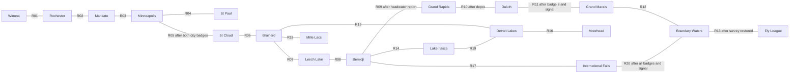

# Minnesota maps and travel contracts

## Region graph

Author each route for worthwhile play rather than filling reserved space. Large routes can use 32 by 24 metatile chunks; compact routes can end in a smaller native map. Central Lakes uses one 32 by 18 metatile exterior. Chunking retains the repository's existing map loading, collision, saved block overrides, coordinate events and connection behavior. It does not introduce another movement system.

St Paul is a required excursion from Minneapolis. The northern Minneapolis gate checks badge slots 3 and 4. Lake Itasca starts as a reachable side destination, then becomes required for the headwaters report before the Iron Range. The Voyageurs loop cannot bypass the survey-restoration gate on the League approach.

## Logical route inventory

`routes/MN_Rxx.json` defines the dimensions, endpoints, districts, main path, loops, trainer parties, pickups, encounters and story dependency. `routes/MN_Rxx.layout.json` defines terrain brush strokes for its source-art blockout.

| ID | Route | Endpoints | Metatiles |
| --- | --- | --- | --- |
| R01 | Driftless Trail | Winona to Rochester | 32 by 20 |
| R02 | Prairie Farm Road | Rochester to Mankato | 30 by 22 |
| R03 | Minnesota River Valley | Mankato to Minneapolis | 24 by 32 |
| R04 | Twin Cities River Crossing | Minneapolis to St Paul | 28 by 18 |
| R05 | River Bluffs North | Minneapolis to St Cloud | 32 by 56 |
| R06 | Pine Country Road | St Cloud to Brainerd | 32 by 44 |
| R07 | Leech Lake Approach | Brainerd to Leech Lake | 32 by 48 |
| R08 | Northern Lake Circuit | Leech Lake to Bemidji | 40 by 48 |
| R09 | Iron Range West | Bemidji to Grand Rapids | 96 by 72 |
| R10 | Iron Range Descent | Grand Rapids to Duluth | 96 by 96 |
| R11 | North Shore Trail | Duluth to Grand Marais | 64 by 144 |
| R12 | Gunflint Trail | Grand Marais to Boundary Waters | 96 by 96 |
| R13 | League Approach | Boundary Waters to Ely | 96 by 144 |
| R14 | Headwaters Trail | Bemidji to Lake Itasca | 96 by 72 |
| R15 | Central Lakes West | Brainerd to Detroit Lakes | 32 by 18; compact replacement |
| R16 | Red River Prairie | Detroit Lakes to Moorhead | 96 by 72 |
| R17 | Border Pines | Bemidji to International Falls | 64 by 144 |
| R18 | Mille Lacs Shore | Brainerd to Mille Lacs | 96 by 96 |
| R19 | Prairie Forest Link | Lake Itasca to Detroit Lakes | 96 by 96 |
| R20 | Voyageurs Border Loop | International Falls to Boundary Waters | 128 by 96 |

Map size follows the authored play. Driftless is 32×20 metatiles in one exterior; River Bluffs is 32×56 across three maps, while the longer North Shore uses twelve maps. The original repeated reserves remain unaccepted blockouts.

## Map identities and chunk seams

Use the semantic name `MnR01C00R00` for Route 1, column 0, row 0, with constant `MN_R01_C00_R00`. A chunk's world metatile origin is `(column * 32, row * 24)`. A route coordinate resolves to chunk `(x / 32, y / 24)` and local coordinate `(x % 32, y % 24)`.

`world.json` explicitly lists all 150 chunk records. It records cardinal adjacency and both directions of each candidate seam. An adjacency is an authoring contract, not permission to add a traversable seam through a forest wall. Emit active connections only at fitted shared edges with matching passable quadrants. Preserve continuous blocked edges where no travel is intended. A whole route must still connect both town gates, every mandatory district and every required story actor.

Equal-sized neighboring chunks use reciprocal `MapConnection` entries with offsets 0. If a chunk at `(c,r)` connects east, the target is `(c+1,r)` and the reverse direction is west. North/south are analogous. Validate at core-tile resolution and in the controller: the connection moves the player into the destination map while maintaining the intended local lane.

Do not use raw screen coordinates as map positions. Core coordinates are twice a metatile coordinate plus its selected quadrant. Do not multiply route-wide positions directly into a chunk's events.

## Route to town gates

The `gatehouse_warp` records in `world.json` name both maps, local gate coordinates, separate arrivals and required flags. These are explicit warp-backed trail gates because the conceptual statewide diagram does not give every town and route a globally consistent rectangular placement. Ordinary chunk travel uses the production connection path.

For each gate pair:

1. Place the collision-backed departure trigger at the reserved gate.
2. Place a distinct arrival record on ordinary FLOOR at the reserved inward landing. An arrival record must not itself be an active warp collision.
3. Target that arrival record's index from the other map's departure trigger.
4. Materialize all trigger quadrants that the chosen panel allows. Use a door-style gate if a warp-panel block is not available.
5. Keep NPCs, signs, item balls and coordinate-event intercepts off both arrivals.
6. Check any badge/story requirement before departure. Dialogue owns input while the gate explains a missing requirement.
7. Walk through and back again in the production controller, including after save/reload and blackout.

The safe-arrival pattern already exists in `crates/crystal-mapgen/src/world.rs` around `add_portal`. Its warp behavior may be studied as an integration reference. Do not invoke that crate's geography or scene composer for this hand-authored world.

## Towns and interiors

Each file under `towns/` fixes the outdoor dimensions, tileset, ports and required interior names. Author complete street blocks with every mandatory door reachable from every active port. Winona starts small; Minneapolis, St Paul, Brainerd and Duluth have multiple readable neighborhoods. Lake destinations have shore circuits rather than urban services pasted onto wilderness.

Every interior must have its own map metadata, block label, script label, event label, spawn data where needed, and an exterior return. Namespace local scripts and object identifiers per map. Do not clone an interior's original Johto return warp or callback into Minnesota.

The first required interior coordinates to freeze are Winona's home stairs and return, field-station door, Rochester clinic, Rochester gym, and both Route 1 town gates. Town dossiers intentionally reserve door fitting until an actual source facade has been selected; the next implementation milestone must supply a door/warp table before exporting that slice.

Boundary Waters now has a [Safari-preserve design](zones/boundary-waters-safari.json): the existing hub is a free ranger basecamp serving all three regional routes and the Q07 shelter. A proposed 48×40 wildlife preserve branches beyond check-in, with four clipped chunks and distinct reed, pine, granite and island habitats. Those candidate chunks remain outside the registered world inventory until authored native terrain and reciprocal entrance events are fitted.
