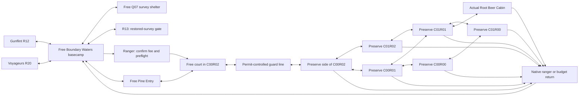

# Boundary Waters Safari Preserve

The historical terrain and hospitality baseline was published in the ignored **450-map** `content-packs/minnesota-boundary-waters.crystalpack`: one continuous **48×40-metatile preserve** in four clipped native chunks, plus the actual **5×4 Root Beer Cabin**. All five production-controller cases pass, including the cabin door/both carpets/passive returns/Continue, outside Dorothy services, grassy portages, Surf seams/barriers and closed admission. Seven selected asset/core-warp tests and all 377 audio checks also pass. **Expedition admission remains closed in the selected pack. Native runtime components now exist, with production-controller and visual acceptance still pending as detailed below.** The optional preserve remains separate from the free 32×24 [Boundary Waters basecamp story contract](../towns/MnBoundaryWaters.json); these fixtures do not claim earned regional progression.

The user’s latest direction makes water the primary geography: **mostly connected lakes with grass and pines around them, including real portages**. The experience follows navigable lake narrows, pine-lined coves, grassy shore pockets and low islands. It is not a broad dry route with decorative ponds. Current rangers truthfully announce closed expeditions and charge nothing. Future admission/return services and **Safari Ball / Bait / Rock / Run** encounters, with neither Pokémon attacking, are the remaining gameplay goal. There is **no ordinary trainer gauntlet or substitute ordinary wild table inside**. Canoe is the visual theme; water travel uses the existing native **Surf** permission and movement system. No new boat controller, free HM bypass or painted-water floor is implied.

## Native expedition implementation in progress

Safari encounters must look like battles: a complete native battle screen,
the selected trainer's back sprite facing the actual wild Pokemon, its native
HUD, and Ball/Bait/Rock/Run below. Keep that composition while presenting a
result. Use the trainer's actual Chris or Kris source art, with counters beside
the trainer. The capture engine owns the encounter; no party member is sent out.

The [native runtime revision](../revisions/boundary-safari-runtime-v01/README.md)
now adds a typed saved session, capture-only Ball/Bait/Rock/Run resolver, real
party/current-box/Pokédex delivery, deferred result/exhaustion, and strict
binary-save compatibility checks. Native staged fee/entry/return transactions,
permit-controlled guard bodies, travel debits and mutation/RNG replay now have
actual-pack component coverage. Committed walking/Surf habitat generation and
saved ranger/capture selections now have component tests on the current730-map
interior union. A first production-controller ranger-to-retirement journey now
passes, with generated wildlife, all four commands and saved choices/results.
The battle UI has reviewed native command/result captures, matching source-art
pixels, distinct trainer back sprites and fullscreen/cursor/cleanup regressions.
Caught-area metadata now resolves the actual native landmark, and a successful
controller catch retains it through storage and Continue. Native rods now open
the same capture battle using the original Minnesota rod/time tables and real
shore/water contact; the Good Rod casting/capture/Continue journey passes.
Native Pokédex/nickname screens, real party/selected-PC delivery and their
saved pages/choices/name drafts now pass production-controller Continue and
clean-stdio checks. The native YES/NO window also has a corrected reviewed
battle composition. A paid ranger-to-lake journey now crosses the Reed and Isle
of Pines grassy portages, visits the real cabin and retains Surf/permit state
through Continue. A separate 500-step journey proves expiry and safe return.
Expiry uses the normal field-dialogue presenter instead of an empty battle.
Other portages/ledges, outward travel, canoe input and complete throw
animation/audio presentation still need work. The authoritative runtime
habitats and Minnesota-only wildlife tables are in
[zone.json](../revisions/boundary-safari-runtime-v01/zone.json); older dimensions,
habitat proposals and species examples below are historical design notes.
The selected pack's gate therefore remains closed and charges nothing. The gap analysis below
records the original engine audit; use the runtime revision for the current
implementation boundary and remaining work.

## Free story contract and future paid preserve

Keep all existing hub ports and the Q07 survey shelter outside expedition rules:

| Free destination | Existing reservation / rule |
| --- | --- |
| R12 Gunflint arrival | East gate meta `(30,12)`, inward landing `(28,12)` |
| R13 League departure | South gate `(16,22)`, landing `(16,20)`; still requires `EVENT_MN_SURVEY_RESTORED` |
| R20 Voyageurs arrival | West gate `(1,12)`, landing `(3,12)` |
| `MnBoundaryWatersSurveyShelter` | Existing 8×6 story interior, accessible without admission |
| Ranger check-in / early-return arrival | Free public dock beside the route junction, distinct safe FLOOR arrivals |

Q07's survey-chief battle remains an ordinary production trainer battle **in the free survey shelter**. Winning sets `EVENT_MN_SURVEY_CHIEF_DEFEATED`; restoring the receiver separately sets `EVENT_MN_SURVEY_RESTORED`, following the existing [MS11/MS12 contracts](../story.json). Neither flag depends on Safari payment, remaining balls, a rare capture, a habitat reward or an active expedition. R20's border-circuit arrival/reward also fires at the free hub. A player with zero money can travel R12 → shelter → eligible R13 and return through R20.



This graph describes the current six-chunk terrain and its real free walking
approach. The court and preserve side of C00R02 are areas of the same map,
separated by actual guard bodies. The seven internal neighbor pairs are
reciprocal native connections, with walking or Surf passages where collision
allows. Ranger admission and return transactions run in
the unselected runtime review; the selected main still keeps paid admission
closed. The story hub/shelter and regional junction never require a permit.

## Complete map and habitat composition

The published exterior uses these exact identities/extents from the zone JSON:

| Chunk | Metatile origin | Size |
| --- | --- | --- |
| `MnBoundarySafariC00R00` | `(0,0)` | 32×24 |
| `MnBoundarySafariC01R00` | `(32,0)` | 32×24 |
| `MnBoundarySafariC00R01` | `(0,24)` | 32×24 |
| `MnBoundarySafariC01R01` | `(32,24)` | 32×24 |
| `MnBoundarySafariC00R02` | `(0,48)` | 32×8 |
| `MnBoundarySafariC01R02` | `(32,48)` | 32×8 |

All seven internal neighbor pairs have reciprocal east/west or north/south
records with offset 0. Core seams are x=64, y=48 and y=96; the bottom row is
clipped, not padded. The free south connection from C00R02 to Pine Entry has
offset -1 with reciprocal north offset 1. Pine Entry links to the hub with
south offset -8 and reciprocal north offset 8. Preserve the regional hub ports
rather than treating Safari as the route between them.

| Habitat reservation | Play and composition |
| --- | --- |
| Reed Marsh: meta `[0,24)` × `[24,40)` | Low reeds and short boardwalk alternate with dry portage. A protected entry landing opens onto the first lake; a grass-lined shore and a short pine portage link onward to a separate landing. Wooper/Quagsire/Yanma establish its identity. |
| Pine Portage: `[0,24)` × `[0,24)` | Narrow pine necks widen into a real encounter clearing. Small shore clearings and a short land crossing connect paired lake landings; any optional ledge needs an ordinary walking return. Cut seals an optional rare-habitat/cache pocket, with no water or side entrance. Stantler/Pineco/Teddiursa distinguish this habitat. |
| Granite Shore: `[24,48)` × `[0,20)` | Connected lake coves, shore grass and small fitted granite outcrops shape an eastern excursion. Avoid a large empty rock plateau. Shuckle/Onix and the proposed rare Larvitar belong here. |
| Quiet Water Islands: `[24,48)` × `[20,40)` | Two readable landings frame a deliberate native Surf channel. An optional island rewards the water trip. Rare Lapras/Dragonair provide capture interest; the preserve journey uses native Surf and paired portage landings. Admission validates Surf access before charging; free story travel stays outside. |

Use the zone JSON's species, levels and seven weighted entries per habitat; do not create a divergent second encounter catalog. Weights and levels are reservations until bound to actual terrain. The implementation must explicitly bind each table to grass/water surfaces: an aquatic table is not permission to put Mantine in dry grass. Rare-pocket exclusivity needs an explicit sub-habitat table before it is advertised; the current habitat tables alone do not make a species unique to a gated pocket.

The source preserve arrival is protected Reed checkpoint FLOOR `(15,73)` in core coordinates. Its native metal gate throat occupies x=11–12, y=68–69; closing that throat disconnects the arrival court from the launch. The return ranger is at `(10,71)`, approached from `(11,71)`. Admission remains in the free hub before charging/warping. These anchors are published: two permanent Officer bodies close the throat and prevent the ordinary arrival from reaching the launch. No session admission/retirement is installed. The separate actual cabin warps pass production input and Continue checks.

Each substantial branch needs a capture opportunity, marker, reward or useful return. Candidate optional rewards are one recovery-item cache in the Cut pocket, one item on the Surf island, and a once-only ranger reward for observing/capturing across the four habitats. Exact item IDs, quantities, marker positions and flags must be added to the authoritative zone before publication. Rewards never gate Q07/R13. Full-bag refusal preserves the pickup or pending reward for retry; a session ending cannot delete an earned reward.

Close every unconnected Surf perimeter with inspected native water rocks or buoys and real BUOY/WALL collision. The proved Johto blue-water rock variants are available; brown land boulders are not a substitute without visual fitting. Leave water seams open only across actual reciprocal neighbors. Inventory **every** placed CUT_TREE quadrant, including canopy variants. Each intended Cut gate must seal declared targets before cutting in combined walking+Surf reachability, then open them through the actual native replacement and prerequisite checks.

## Future admission, budgets and return

The intended, unimplemented admission is **₽500, 30 session Safari Balls, 500 successful authoritative tile transitions**. It has no real-time limit. The party is retained; no Bug Contest party backup or one-Pokémon restriction applies.

1. Ranger explains fee, balls, steps and retirement. Declining changes nothing.
2. Preflight native Surf move/badge access, valid destination/return, inactive expedition, no active contest/link/battle ownership conflict, sufficient money and `PokemonStorage::has_capture_space_in_box(current_pc_box)`. If capacity is full, explain party/current-box storage and let the player resolve it outside before paying.
3. One staged runtime transaction deducts the fee, creates the session, assigns counters and warps to the safe preserve arrival. Failed validation/warp commits neither debit nor session. Repeated dialogue confirmation cannot charge twice.
4. Continue resumes the same position, balls, steps, habitat, random state and pending encounter/return. It never gives a fresh budget or charges again.
5. Manual early return, last resolved ball or last successful step ends the expedition safely. Preserve catches, Pokédex updates, permanent pickups and earned reward claims. Clear expedition-only resources and return to free basecamp; unused session balls never become bag items.

Count **one unit per committed native movement result**, including normal walking, Surf travel, a successful native ledge movement and a connected-map crossing. A ledge's animation/intermediate pixels do not add extra debits; if the engine produces a preceding ordinary move and a later jump as two successful movements, they cost two units. Turning, wall bumps, rejected ledges, dialogue, menus, field animations, battle turns and waiting cost zero. Surf launch/dismount costs one only when it actually commits a tile transition; changing mode in place costs zero. A step onto an exit warp costs one; the subsequent scripted arrival does not manufacture another step.

The current ordinary `CountStep` path is **not a sufficient hook**: `game_data_overworld_and_saves.rs` handles connections, warps and coordinate events before calling ordinary step events. Add a dedicated expedition decrement at the authoritative successful-travel boundary, including relevant field-move transitions, exactly once. Do not count button presses, rendered walk frames or frontend position differences.

At zero steps, finish the committed movement/landing, suppress a new random encounter, show the ranger return notice and perform the safe return. At zero balls, finish capture/storage or failed-throw/flee presentation before returning. Expiration must not teleport through an open dialogue/nickname prompt. An explicit `ending` state defers settlement until the current result releases input. Fly/Teleport/Dig/Escape Rope or another outward transition must settle the session through the same policy, never retain a live permit outside the preserve. An inactive player cannot enter from a Surf seam, stale warp or alternate field-move arrival.

## Future capture-only encounters

Implement the menu as a real production **Ball / Bait / Rock / Run** branch; it does not yet exist. It has no Fight, move list, party-switch command, ordinary Pack items or enemy attack. Bait and Rock are session commands, not fabricated bag entries. Run leaves the current encounter safely; it does not retire the whole expedition.

Proposed turn order:

1. Validate active permit, encounter identity, command phase and storage capacity before a Ball attempt.
2. Ball debits exactly one session ball and resolves capture through authoritative RNG. A successful catch is delivered through native party/current-PC-box and Pokédex logic. Failed catches continue to the wildlife response.
3. Bait applies bounded eating state: lower flee probability and lower catch chance. Rock applies bounded anger state: higher catch chance and higher flee probability. Neither consumes a ball. Repeated use refreshes a bounded duration; do not silently stack unlimited modifiers.
4. On a failed Ball, Bait or Rock, resolve the wild Pokémon's flee decision, decrement the disposition duration once, and return to the capture menu if it remains. Run and a successful catch do not get an extra enemy action.
5. Reset per-encounter disposition on encounter completion, while preserving the expedition budgets. No HP damage, PP use or battle EXP is awarded.

The zone JSON now fixes original **`mn_safari_v1`** balance values for implementation. Neutral wildlife flees when one native random byte is below 64/256; Heracross/Lapras/Dratini use 96/256, Larvitar/Dragonair 128/256. Bait halves both catch rate and flee threshold; Rock doubles both, with integer floor and clamp 1..255. A Bait/Rock command replaces the previous disposition for `2+(random_byte &3)` wildlife responses, without stacking. A failed Ball or completed Bait/Rock draws flee RNG before decrementing disposition once. Successful catches and Run do not draw flee RNG. Native species catch rates, full-HP/no-status encounters and the supplied Safari Ball multiplier/wobble/storage path remain authoritative in an explicit Safari context. These are original mod choices, not a claim of bit-for-bit Crystal Safari fidelity. Golden tests must establish the configured thresholds and draw order; do not mutate the species catalog, fake attacks or invoke enemy combat AI.

If party and current box fill mid-expedition, refuse another Ball before consuming the ball or rerolling the wild Pokémon. Explain storage and allow Run/early return. Do not first report a catch and then discard it. Any interrupted capture-storage/nickname result must either complete once or remain recoverable across Continue; a pending result cannot also resolve as a flee/timeout.

## Existing code and concrete implementation gaps

The inspected checkout provides useful pieces, not Safari gameplay:

| Evidence | What exists / required change |
| --- | --- |
| [`battle/capture.rs`](../../../crates/crystal-core/src/battle/capture.rs) | Recognizes battle-only `SAFARI_BALL`; the supplied pack has its 3/2 ball rule and wobble/storage helpers. The supplied normal item catalog has **no SAFARI_BALL, BAIT or ROCK item**. Dedicated session ball handling is required; do not route it through normal bag consumption. |
| [`state.rs`](../../../crates/crystal-core/src/state.rs) | Has serialized `BugContestState`, but no Safari expedition state. `BattleMemory` has Inactive/Wild/StaticWild/Trainer; saved wild-battle validation does not accept a Safari battle type. `ENGINE_SAFARI_ZONE` appears in spawn-cleanup support, not a complete session implementation. |
| [`battle/turn.rs`](../../../crates/crystal-core/src/battle/turn.rs) | `BattleAction` supports Move/Switch/Item/Ball/Run variants, not Bait/Rock or capture-only response state. Add a focused Safari core resolver/state, with deterministic random sources and explicit outcomes. |
| [`game_data_encounters_and_loading.rs`](../../../crates/crystal-assets/src/game_data_encounters_and_loading.rs) | Normal field encounters select Normal or Contest. Add permit/map/habitat routing to the real Safari kind, typed weighted habitat sources and saved-origin validation. |
| [`game_data_items_and_battles.rs`](../../../crates/crystal-assets/src/game_data_items_and_battles.rs) | Contest has PARK_BALL-counter branches; ordinary throws consume bag items and resolve combat. Safari needs a dedicated session-counter transaction and no enemy attack. Existing capture completion must accept the new kind and retain caught data/storage semantics. |
| [`box_storage.rs`](../../../crates/crystal-core/src/models/box_storage.rs) | Actual capture delivery fills party first, then the **current** PC box. Do not promise automatic searching of other full boxes without implementing it. |
| [`special_routines.rs`](../../../crates/crystal-core/src/systems/special_routines.rs) / runtime mutation layer | Contest lifecycle/timer patterns are reusable references. Add typed Safari entry/end/command mutations and parsed script bindings; the existing Contest has clock timer, party backup, judging and replacement-catch semantics that do not equal this design. |
| [`bevy_shell/start_menu.rs`](../../../crates/crystal-bevy/src/bevy_shell/start_menu.rs) | Contest's visible menu still includes FIGHT/PKMN/PARKBALL/RUN. Add Safari's actual four commands, counters, action handling, text ownership, return and status surfaces through `VisibleShellController`. |

Proposed authoritative state: `SafariExpeditionState { zone_id, phase: inactive|exploring|encounter|ending, balls_remaining, steps_remaining, return_map/warp, current_habitat, pending_end_reason, encounter_state }`. Per-encounter state retains the actual wild Pokémon/origin, eating/anger duration, turn identity and pending capture result. Persist this through core state, runtime snapshots and validated saves. Define compatibility for older inactive saves explicitly; reject an active Safari save whose zone/config/origin references are absent rather than resetting its budgets. Mirror an engine flag only if native scripts need it; do not use sparse script variables as the only state.

Legacy saves lacking Safari state must default to inactive and preserve unrelated party/bag/story. Validate active zone/map/return references, nonnegative bounded counters and pending capture/end consistency; invalid state must fail recoverably rather than invent a fresh paid session.

Add an explicit capture-only battle kind, preferably a typed `BattleMemory` branch that does not require an active player combatant. Extend all enum visitors, save/reference validators, snapshots and capture completion deliberately. Add `SafariAction`/outcome and staged runtime mutation commands in focused leaf modules. The graphical client, 2D renderer, TUI and MCP must all press the same `VisibleShellController` inputs; **no second dispatcher in geothite/crystal-tui**, direct `RuntimeGameShell::tick()` workaround or JavaScript capture simulator.

## Verification and implementation order

The following are required tests, **not tests already implemented**:

- `safari_entry_preflight_is_transactional`: decline, insufficient money, full current storage, invalid return and duplicate confirmation preserve money/state; accepted entry debits 500 once and gives 30/500.
- `safari_successful_travel_counts_once`: walking, Surf launch/travel/dismount, ledges and native seams count documented commits; bumps, turns, dialogue, animation, menus, waits and failed movement do not. Exercise the exact last-step boundary and repeated seam crossings.
- `safari_capture_only_commands_are_authoritative`: menu exposes all four actions; attacks/Pack/switch/enemy AI are rejected; Ball changes the real counter; Bait/Rock alter configured catch/flee state and expire correctly under deterministic RNG.
- `safari_capture_storage_and_end_are_atomic`: success stores the actual Pokémon/Pokédex/caught location once, failure/flee returns control, full storage refuses without loss, final-ball catch survives return, pending nickname/result survives Continue.
- `safari_continue_retire_and_escape_preserve_session`: no fee/budget refresh, no duplicate rewards, no permit surviving outside, no entry without a permit, safe manual/exhaustion/outward-field-move return.
- `boundary_waters_free_q07_path_ignores_safari`: zero-money route arrivals, chief loss/retry, chief win/receiver restoration and R13 gating use the free shelter; R20 side reward cannot bypass restoration.
- Whole-map walking+Surf reachability, every clipped seam both ways, all native Cut denial/removal/target/reset-or-persistence behavior, ledge/reverse/return, visible water-rock perimeter closure, production MCP/TUI clean stdio, source preservation and all audio checks.

The continuous 48×40 terrain and actual cabin are already published and reviewed whole. The next native vertical slice is transactional paid admission, one authored encounter patch, the four-command loop, real capture/storage, safe retirement and saved counters. Keep ordinary admission closed until it passes, then expand the four configured habitat tables.

`tools/review_boundary_safari.py` renders the authoritative whole source map without Cargo; `tools/review_boundary_native.py` compares the actual published file and renders its native source pixels. Exact geometry/art comparison and the five controller cases now pass. Continue headless native review at the same position/time/facing/state for future changes. Keep preserve packs, screenshots and fixture saves ignored. Future Safari session/capture requirements remain design evidence until separately implemented and tested.

## Latest geography correction

The first dry-land terrain proposal is superseded. The preserve must be mostly connected lakes bordered by grass and pines, with narrow navigable water channels and genuine dismount/walk/relaunch portages between some basins. Source review must demonstrate actual WATER coverage, connected-water components, paired landing reachability, and short useful shore trails. The published 48×40 extent retains that geography; broad empty lawns and a continuous dry ring are rejected. Safari Surf is an optional-zone prerequisite, checked before payment, while the free hub/story path remains walkable.

## Campsites, pine enclosure and the Root Beer Lady

The latest user direction adds **more land, more pines, wider useful portages, pine forest surrounding the lakes and campsites**. Earlier water-percentage targets were implementation choices and are superseded. Preserve the connected-lake identity while giving shore/portage land enough room for clearings and activities. Campsites need safe landings, a reachable fire ring/seating and a discovery, observation or service; do not scatter empty decorative camp props.

The published Isle of Pines cabin/dock/yard includes **Dorothy Molter, the Root Beer Lady**, using native `SPRITE_GRANNY`. The [Dorothy Molter Museum educational guide](https://www.rootbeerlady.com/wp-content/uploads/2016/04/Dorothy-Molter-Ed-Guide.pdf) supports the Knife Lake/Isle of Pines, homemade root beer and nursing-care identity. Her dialogue and game interactions are original mod design. Freeze the exterior DOOR, distinct safe return, real interior rows and NPC approach in the terrain contract.

The published `ROOT_BEER` item uses native `RestoreHPEffect`, 60 HP, price 300 and the usual party-targeting surface. Its typed definition derives from native Lemonade behavior while preserving every original drink. First gift sets its saved event only after actual delivery; a full bag preserves it for retry. Repeat purchase uses native money/bag transactions. The actual nursing rest uses `HealParty`; no Safari session or budget is initialized or refilled. Her stop is optional and never gates Q07. The additive item and prepared service helper pass nine native item/mutation/transaction tests. Outside service and the actual cabin are published and pass the five-case preserve controller suite. Conditional one-person indoor relocation remains future work.

## Published map and current source review

[Complete actual native preserve](../renders/boundary-safari/native-compare/whole-native-preserve-614fc4ce9938.png) · [actual native-pack cameras](../renders/boundary-safari/native-compare/native-camera-sheet-539ea1ef5f0d.png). The 48×40 layout now has enclosing pine banks, more shore land, four campsite clearings with real native wooden seats/unlit stone rings, a visible fenced entry checkpoint and four actual grass-lined portages and Dorothy’s rustic Isle of Pines cabin with a reachable dock/yard. Exact campsite, NPC, portage, door, landing and return anchors live in [the terrain layout](../zones/boundary-waters-safari.layout.json).

The native Rust layout compiler and Safari-only seating import pass focused source-art/collision checks. The import preserves earlier source content and reproduces the actual Kanto08 bench pixels/palettes; it does not reinterpret a trash bin as a fire pit. These are terrain/art proofs, not an implemented Safari encounter/session. The published Dorothy exterior door is `(51,39)`, with distinct safe return `(51,40)` and actual room `MnBoundaryRootBeerCabin`.

Dorothy’s [authoritative cabin/interior](root-beer-cabin.json) and [two-state preview](../renders/root-beer-cabin/two-states.png) now replace the generic room reservation. Native traditional-house art provides a real table/cushions, supplies and a counter; the default interior is empty while Dorothy is outside. The separate serving preview describes a future one-person relocation scene, not two simultaneous Dorothys. Passive interior arrival 3 at `(5,6)` and both carpet exits 1/2 now pass native core resolution, production entry/return/no-bounce and Continue checks.


## Entry gate and grassy portages revision

The latest user request adds an **entry gate and more grassy portages**. The Reed arrival now has authentic metal fence runs and two blocking vertical posts around a two-core-tile opening. Pine backstops close the shoulders. The return ranger stands beside the opening; the launch cannot be reached from the forecourt without crossing this throat. The checkpoint geometry is visible in [the entry camera](../renders/boundary-safari/viewport-entry_gate.png). Future paid admission belongs at the free basecamp before preserve access. The current native Officers close both lanes and truthfully report that expeditions are unavailable; no session checks or fee are invented.

| Portage | Dry landings → adjacent water, core coordinates | Walking crossing | Minimum grass | Paddle alternative |
| --- | --- | ---: | ---: | --- |
| Reed Pocket | `(3,58)` → `(3,57)`; `(13,60)` → `(14,60)` | 12 steps | 4 | Separate pocket lake; land transfer required |
| Pine Pocket | `(22,21)` → `(21,21)`; `(29,21)` → `(30,21)` | 7 steps | 4 | Separate pocket lake; land transfer required |
| North Pine Arms | `(38,17)` → `(37,17)`; `(57,21)` → `(58,21)` | 23 steps | 8 | 39 water-only steps around the peninsula |
| Isle of Pines | `(36,42)` → `(35,42)`; `(65,45)` → `(66,45)` | 32 steps | 6 | 44 water-only steps around Dorothy’s island |

The last two are useful crossings between connected lake arms; they do not falsely split the main lake chain into isolated ponds. Source checks require real WATER at each launch, continuous land reachability, no dry bypass around the declared grass and a measured all-water alternative. Grass now fills wider necks and approaches instead of two tiny strips. New signs distinguish the North Pine and Isle of Pines portages. The four-portage/cabin sample itinerary measures 332 geometric movement steps; this is a planning measure, not a native session-counter test.

## Production Safari trace and smallest implementation seam

This read-only audit inspected the current Rust paths and the actual ignored `content-packs/text-tui.crystalpack`. **No Safari runtime behavior was implemented or executed by this audit.** The pack contains `SafariZoneBeta`, `SafariZoneFuchsiaGateBeta`, `SafariZoneMainOffice` and `SafariZoneWardensHome`. The beta preserve/gate and office have map-section scripts/warps, but no admission or Safari lifecycle scripts. The warden's granddaughter explicitly describes the source Safari as closed. Its `SAFARI_BALL` capture rule is the native3/2 multiplier; there are no ordinary `SAFARI_BALL`, `BAIT` or `ROCK` item entries. These source leftovers are useful art/capture material, not a functioning Kanto Safari to switch on.

| Exact existing boundary | Reuse and missing behavior |
| --- | --- |
| [`VisibleShellController::press`, `press_buttons`, `save`, `load_save`](../../../crates/crystal-bevy/src/bevy_shell.rs:606) | Already owns production input and visible settling for every frontend. Keep all new actions here. [`economy.rs::visible_battle_action_ids`](../../../crates/crystal-bevy/src/bevy_shell/economy.rs:2334) still returns Fight/Pokemon/Pack/Run; its confirmation handler routes Contest Pack to `PARK_BALL`. [`battle_main_menu_entries_for_type`](../../../crates/crystal-bevy/src/bevy_shell/start_menu.rs:8703) only substitutes PARKBALL in the ordinary menu. None supplies Ball/Bait/Rock/Run. |
| [`GameState`, `BugContestState`, `BattleMemory`](../../../crates/crystal-core/src/state.rs:73) | Serialized contest balls, timer, party backup and replacement catches exist. Safari state does not. `BattleMemory` only has Inactive/Wild/StaticWild/Trainer, and [`RuntimeBattleKind`](../../../crates/crystal-runtime/src/lib.rs:1688) mirrors those. A Contest string would retain combat, timing and party rules that violate this design. |
| [`resolve_capture_attempt_exact`, `CaptureAttemptContext`](../../../crates/crystal-core/src/battle/capture.rs:463) | Reuse native RNG, Safari Ball ratio and wobble handling. The context has no eating/anger catch-rate modifier. A focused capture modifier must apply before the native ball/HP calculation, preserving integer rounding and the species catalog; changing the ball ratio or stored species is not an equivalent implementation. |
| [`throw_ball_at_active_battle_with_divider_inner`](../../../crates/crystal-assets/src/game_data_items_and_battles.rs:2267) | Requires an active player combatant. Only Tutorial and Contest bypass ordinary bag consumption; Contest decrements `bug_contest.park_balls_remaining`. A Safari throw needs its own staged session-ball/storage transaction, and must avoid the ordinary enemy-AI turn. [`RuntimeGameShell::resolve_active_battle_ball_turn_with_enemy_selectors`](../../../crates/crystal-runtime/src/runtime_shell_actions.rs:3101) explicitly stages combat selectors, so it is not the capture-only adapter. |
| [`complete_captured_pokemon`](../../../crates/crystal-core/src/battle/capture.rs:974), [`PokemonStorage::has_capture_space_in_box` / `register_capture_in_box`](../../../crates/crystal-core/src/models/box_storage.rs:287) | Reuse actual Pokémon delivery, party-first/current-box storage and Pokédex logic. `complete_active_wild_capture_result` currently extracts only Wild/StaticWild and has Contest-specific retention. Extend it deliberately for the new encounter kind; final-ball capture/nickname/end must commit once. |
| [`apply_overworld_input_with_movement`](../../../crates/crystal-assets/src/game_data_overworld_and_saves.rs:943) | Ledge jumps are normalized into one `StepOutcome::Moved` at the authoritative mutation boundary. Ordinary `CountStep` runs only after trainer sight, connections, warps, coordinate events and phone checks. Debit expedition travel before those branches can bypass counting; zero steps must suppress a new encounter while preserving the committed landing. Never count visual frames or input presses. |
| [`use_surf_field_move`](../../../crates/crystal-assets/src/game_data_items_and_battles.rs:1079), [`apply_script_movement`](../../../crates/crystal-assets/src/game_data_scripts.rs:3971) | Surf first prepares `pending_surf_field_move`; actual `UsedSurfScript:9` applies the player movement and clears it after validating its destination/step count. This separate successful Surf-launch commit must share the travel debit, without charging mode preparation or generic NPC movement. [`commit_pending_field_travel`](../../../crates/crystal-assets/src/game_data_items_and_battles.rs:1451) is the common Fly/Dig/Teleport outward transition to settle an active expedition. |
| [`WildEncounterData`, `WildEncounterZone`](../../../crates/crystal-core/src/world/encounters.rs:205), [`check_wild_encounter_after_step`](../../../crates/crystal-assets/src/game_data_encounters_and_loading.rs:916) | Existing zone rectangles replace only grass tables/rates and enable encounters on ordinary land; they have no per-zone water table. Copying four Safari habitat names into those zones would neither implement the prescribed weighted grass/water tables nor preserve grass-only portage opportunities. Add explicit validated per-habitat surface/config selection while reusing native encounter materialization/RNG and exact origin checks. |
| [`CrystalRuntime::save_game`, `load_save`, `validate_save_state_for_runtime_pack`](../../../crates/crystal-runtime/src/runtime_catalog.rs:4492), [`validate_save_references_for_runtime_pack`](../../../crates/crystal-runtime/src/runtime_session.rs:4325) | Reuse native save identity, validation and Continue. Add explicit Safari state/config/map/return/pending-result validation. [`validate_saved_wild_battle_origin_reference`](../../../crates/crystal-core/src/state.rs:5707) currently permits Normal/Fish/Roaming/Contest/Tree only. An invented Safari string cannot bypass that contract. |

`ENGINE_SAFARI_ZONE` is currently only observed/cleared by [`warp_to_spawn_point`](../../../crates/crystal-core/src/systems/special_routines.rs:4392); it is not admission or a saved expedition. The `SFX_GOT_SAFARI_BALLS` reference in the visible slot-machine animation is a sound reuse, not a Safari start routine. Dorothy's existing engine-flag/script-memory sentinel tests likewise prove those resources stay unchanged during hospitality; they do not establish a serialized Safari session.

The smallest honest production slice needs one focused core Safari state/action/resolver leaf and one pack-facing Safari mutation leaf, with narrow existing-enum/controller wiring. The state must own active/ending phase, zone/config, balls/steps, return destination, actual encounter/disposition and pending capture/end. The asset leaf should stage validated admission debit+safe warp, one travel debit, four capture-only actions and safe retirement using the existing runtime mutation/journal pattern. A small visible Safari handler then consumes those typed mutations through the existing production cursor/input owner; it must not dispatch game rules independently. First bind one actual habitat and ranger to all four actions, real storage and safe return before expanding to the complete preserve. These are proposed missing extensions, not implemented function names or passing tests.

Backward compatibility needs more than `serde(default)`: [`SaveGame::validate`](../../../crates/crystal-core/src/save.rs:319) verifies the stored state hash, and [`game_state_checksum_unchecked`](../../../crates/crystal-core/src/multiplayer/mod.rs:3011) hashes the authoritative bincode serialization. Adding a serialized field can change old inactive hashes. Choose an explicit supported migration/checksum policy and test actual old save bytes; retain exact modpack/pack identity checks. Never reset an unrecognized active session to give fresh resources. Include the cabin in allowed expedition maps, charge actual interior movement, preserve its hospitality counters, and finish any pending result before retirement. Free Q07/basecamp/R12/R13/R20 access remains outside these hooks.

The current complete rerender takes about 0.4 seconds after pack loading. Whole preserve, entry gate and all portage cameras were inspected. Native Rust terrain compilation, native session/Surf mounting and actual grass encounters are separate verification stages.

## Prepared production-controller terrain and hospitality review

`crates/crystal-bevy/src/bevy_shell/tests/boundary_waters.rs` contains five ignored tests for the actual group61 overlay. **All five passed in Root’s executed run against the source-repaired canonical pack**, including cabin returns/Continue, hospitality, closed admission, four portages and lake seams/barriers. No separate script interpreter, disposable house, direct movement mutation or alternate input dispatcher is used. Explicit party/badge/location setup is documented below.

The fixture explicitly sets review location, CHRIS, one legal level60 Mew with Surf, eight Johto badge bits and1000 money before any input. The hospitality case additionally starts that partner100HP below maximum, poisoned and at zero SurfPP. Those inputs are test setup, not earned regional progression. Tests placed inside the closed preserve are terrain inspection fixtures; they do not constitute paid admission. Neither `ENGINE_SAFARI_ZONE` nor Safari ball/step memory is injected, and the tests require them to remain inactive/absent throughout.

| Test suffix after `boundary_waters_controller_` | Actual production behavior required |
| --- | --- |
| `five_maps_single_outside_dorothy_and_both_cabin_returns` | Exact four clipped exterior chunks plus5×4 cabin,1940 blocks, eight neighbor records, one outside Granny and empty cabin; no ordinary exterior encounter tables. Actual `(51,39)`door enters cabin `(5,6)`Floor, walking back onto that Floor is passive, Continue stays inside, both `(5,7)`/`(6,7)`carpets return to distinct exterior `(51,40)`Floor, and stepping back onto that exterior arrival does not bounce. |
| `closed_admission_charges_nothing_and_blocks_the_real_gate` | Real `(11,69)`/`(12,69)`Officer bodies and Reed ranger say `EXPEDITIONS CLOSED`; attempts to walk through both guarded throat tiles fail; actual money, party and bag are preserved. No permit or expedition state appears. |
| `actual_outside_gift_drink_rest_shop_and_continue` | Talk to Dorothy at `(49,43)`from `(50,43)`using `BWS_ROOT_BEER_LADYRootBeerService`. Gift event stays false before acceptance, native delivery grants exactly one bottle, and the gift alone does not heal. Decline rest/shop, drink through Start→Pack→Use→party to restore exactly60HP and consume it without restoring PP; return for actual `HealParty` HP/status/PP recovery, buy one bottle through the real300-money shop transaction, Continue exact party/bag/money/event/location, then refuse both services without a second free gift. |
| `four_grassy_portages_have_native_launches_and_dismounts` | At all four declared portages, native Surf launches into each adjacent WATER tile and movement back onto the actual landing dismounts. Walk the published land path between paired landings through production presses and cross at least the declared4/4/8/6 grass tiles. No ordinary encounter table is fabricated as a Safari substitute. |
| `all_four_lake_chunks_and_real_rock_pine_barriers` | Paddle a published ordinary-WATER path through all four native chunks, reject native pine WALL east of `(89,73)`and blue-water BUOY west of `(40,46)`, then dismount at Isle landing `(36,42)`. Audit all348 outer perimeter cells: native pine WALL banks enclose the current layout; interior lake rocks are BUOY, and internal reciprocal water seams remain open. |

A read-only source cross-check against the supplied native art pack confirmed the fixture routes before publication: portage shortest walking paths are12/7/23/32 steps with4/4/9/6 grass; the minimum-grass contract remains4/4/8/6, since the shortest North Pine path need not minimize grass. Planned main-lake paddle legs are51/76/48/47 steps, with native collision `WALL` at `(90,73)`and `BUOY` at `(39,46)`. Every outer perimeter cell is `WALL` in this source revision. These are fixture-planning checks, not native movement/test results.

The publisher's verification command after registering the leaf is:

```sh
CRYSTAL_BOUNDARY_WATERS_TEST_PACK="$PWD/content-packs/minnesota-boundary-waters.crystalpack" \
  cargo test --locked -p crystal-bevy boundary_waters_controller_ -- --ignored --test-threads=1
```

`CRYSTAL_BOUNDARY_WATERS_HOSPITALITY_SAVE` optionally retains the actual completed hospitality save at a unique ignored destination for later same-state MCP review; otherwise temporary saves are removed. Cabin Continue uses its own unique temporary save. The executed cases include actual temporary save/Continue checks; retaining a named optional save artifact is a separate action.

Full-bag gift refusal/native retry already has a separate deliberately synthetic-capacity component/controller fixture in the Root Beer helper tests. This actual preserve test does not inject aliases or invalid inventory to simulate a full pocket. Safari fee/balls/step accounting, paid admission, capture-only Ball/Bait/Rock/Run, habitats/encounters, retirement/exhaustion, indoor Dorothy relocation and earned Q07 journey remain implementation work and are not claimed by the terrain/hospitality suite.

### Actual first controller run: four pass, cabin inventory assertion repaired

Root ran the registered five-test suite against the published450-map Boundary Waters pack; `.local/boundary-controller-current.log` records **four passed, one failed** in6.97s. The actual outside gift→Pack drink60HP→rest HP/status/PP→300 shop→Continue test passed. All four grassy portage Surf-launch/dismount cases passed, as did four-chunk lake travel/barriers and closed admission without charges. Those are native production-controller results on the actual preserve, not source-only planning.

The remaining cabin test stopped before entering the room because it compared `runtime_map_metadata` keys, which are uppercase native constants, with map display names. The leaf now compares metadata values' `name` fields and also resolves per-exterior `map_id` by that field; the incorrect second display-name key lookup was repaired at the same time. All existing door, both carpets, passive Floor and cabin Continue checks remain intact and pending the rerun. This bounded fixture assertion repair changes no game state, geometry, scripts or publication. Scoped `rustfmt --check` passes; Root owns recompilation/rerun. No five-of-five or cabin-input success is claimed from the initial run.

## Published native terrain comparison and visual review

The earlier source-only/unregistered status above is superseded for **terrain, the actual cabin and outside hospitality**. Root published the ignored `content-packs/minnesota-boundary-waters.crystalpack` and reported all four focused native asset tests passing. This author then independently loaded that actual file: **450 maps**, content hash `08c7c51fc459d7ba3a01c5afb7962a65bf2e842f5e17e1b5f29efad3d1386c3b`. Expedition admission remains truthfully **closed**. Publication does not implement Safari fees, balls, steps, capture-only battles, encounters, retirement, Dorothy relocation or earned regional travel.

The new read-only [`review_boundary_native.py`](../tools/review_boundary_native.py) reuses `load_pack`, `SourceArt`, `layout_blocks` and the existing source-sprite helper. It neither exports nor changes a pack, layout, map, catalog or runtime dispatcher. Reproduce the native comparison/render from this checkout:

```sh
.local/minnesota-review-env/bin/python planning/minnesota/tools/review_boundary_native.py \
  --pack content-packs/minnesota-boundary-waters.crystalpack
```

The actual file passed all **1,920 exterior blocks** against the authoritative Rust-compatible layout strokes and all **20 cabin blocks** against the authored room rows. The exact four clipped native sizes are 32×24, 16×24, 32×16, 16×16; the cabin is 5×4. All 20 source actors retain their identities, core coordinates, sprites and facings. The two additional permanent Officers are exactly `(11,69)` and `(12,69)`, face south, and invoke native closed-admission dialogue saying no fee is charged. All 13 source sign positions/identities match. Eight actual reciprocal connection records preserve all four internal seams, with 32/16/38/20 paired WATER cells respectively for NW–NE, SW–SE, NW–SW and NE–SE. All 348 perimeter cells block walking/Surf; the actual ordinary arrival flood contains 42 cells and cannot reach launch `(3,58)` through the guarded throat.

All 128 original Johto blocks in the published preserve tileset match original source pixels **and collision**. The four imported recipes 80–83 match their actual Kanto source glyph rows, palettes and collision recipes, including the rearranged north dock rail and native wooden camp seat. The complete native terrain is pixel-identical to the source terrain render. The actual cabin is empty, with exactly one Dorothy outside at `(49,43)`. Exterior active DOOR 1 `(51,39)` and passive FLOOR 2 `(51,40)` both target cabin passive FLOOR 3 `(5,6)`; cabin carpets 1/2 `(5,7)`/`(6,7)` and its passive record 3 all pair to exterior return 2. Static collision and record comparisons establish those contracts; production warp/input/Continue proof belongs to the controller suite.

Inspected immutable outputs from the actual published pack:

- [Whole native preserve, 1536×1280 source pixels](../renders/boundary-safari/native-compare/whole-native-preserve-8dc1ad746283.png).
- [Twenty-five native-pack camera crops](../renders/boundary-safari/native-compare/native-camera-sheet-fb4fd6a89eaf.png), each 160×144 source pixels, with separate integer 4× exports. These are static source-pixel crops with actual native actors, without an invented player or input state.
- [Actual empty cabin, integer 4×](../renders/boundary-safari/native-compare/actual-empty-cabin-4x-250182c24032.png) and [original 160×128 pixels](../renders/boundary-safari/native-compare/actual-empty-cabin-b1f01305944b.png).
- Individually inspected [outside Dorothy](../renders/boundary-safari/native-compare/camera-root_beer_lady-dfd8c3cdd194.png), [closed entry](../renders/boundary-safari/native-compare/camera-closed_guards-d9a11f9c28c1.png), [weak central lake camera](../renders/boundary-safari/native-compare/camera-central_open_water-b386b5b9e361.png) and [Quiet Island camp](../renders/boundary-safari/native-compare/camera-bws_quiet_camp_camp-7ce3018215ec.png).

The published geography retains readable enclosed pine banks, paired grass portages, protected dock decks, an identifiable cabin yard and a compact functional interior. The actual gate bodies visibly close both lanes. Remaining visual limits are explicit: central-channel/open-water cameras can contain almost entirely blue water with little orientation context; the four camps repeat similar four-stone rings; and Quiet Island’s north-east stone at `(70,63)` visually overlaps the bottom of the marker at `(70,62)` because native sprites extend above their occupied tile. Those positions are exact source preservation, not an unnoticed publication mismatch. This read-only pass makes no geometry revisions or final visual acceptance claim; any bounded source correction must be republished and rechecked by the owning publisher.

The comparison plus full render/cameras took 0.23–0.34 seconds across two runs after pack loading. The immutable report is ignored at `renders/boundary-safari/native-compare/native-compare-08c7c51fc459.json`. Root is separately executing headless production captures and the production-controller suite; this source-pixel comparison does not replace either, and no controller pass is inferred here.

## Bounded Quiet Island marker correction awaiting republication

The concrete Quiet Island sign/stone overlap found in the native review above is corrected in the authoritative layout. `BWS_QUIET_CAMP_MARKER` moves from core `(70,62)` to `(72,62)`; the camp interaction approach moves from `(69,62)` to safe adjacent FLOOR `(71,62)`. The marker stroke, native sign event anchor and campsite interaction contract now agree. The north-east stone stays at `(70,63)`, two walking columns west of the sign, leaving a visible column between their art. Actual 16px sprite bounds, including the native 4px upward stone overhang, no longer overlap the sign.

This is exactly a two-metatile edit: `(35,31)` changes 45→02 and `(36,31)` changes 02→45. Every other one of the 1,920 exterior blocks matches the previously published native pack. All 20 source actors and their positions, four stone rings/benches/footprints, ports, portages, grass requirements, ledges, cabin and water closure remain unchanged. No filler or additional clearing is introduced.

Executed the current source CLI:

```sh
.local/minnesota-review-env/bin/python planning/minnesota/tools/review_boundary_safari.py \
  --pack content-packs/text-tui.crystalpack
```

It passed with no errors in 628.5 ms after loading. Portages retain 12/7/23/32 walking steps, 4/4/8/6 minimum grass steps and 39/44 connected-arm paddle alternatives; internal water pairs remain 32/16/38/20 and no outer WATER cell appears. Inspected the [entire corrected source preserve](../renders/boundary-safari/whole-preserve-565479ff.png) and [immutable Quiet camp camera](../renders/boundary-safari/quiet-marker-clearance-5aebf9f50204.png). The sign is clearly separate from the stone and both marker approach and seating remain legible. This whole source preview does not add the publisher's two closed-admission Officers; their existing native contract is unchanged.

The previous 450-map `08c7c51f…` file is deliberately stale against these two source changes: `review_boundary_native.py` was rerun and correctly rejected it with `All 1920 native exterior blocks must match source strokes`. Root owns republication from the stable 445-map base and subsequent native comparison/controller/capture reruns. The prior native evidence remains historical; this paragraph does not claim the corrected source is already published or that Safari admission has opened.

## Production warp failure and native constant repair

Root's actual controller run passed four preserve tests, but cabin entry failed at the real destination boundary: exterior warp 1 carried `target_map: MnBoundaryRootBeerCabin` alongside `target_map_constant: MN_BOUNDARY_ROOT_BEER_CABIN`. The earlier static record tests and source-pixel comparison did not catch this. The cabin helper had incorrectly replaced the native constant with a map name in that field; this was an authoring defect, not a reason to weaken the runtime validator.

The owned cabin helper now retains the exact native constant in **both** target fields. Exterior records 1/2 use `MN_BOUNDARY_ROOT_BEER_CABIN`; cabin records 1/2/3 use `MN_BOUNDARY_SAFARI_C00R00`. `GameData::resolve_warp_transition` resolves these constants to the real PascalCase map identities through the registered maps and their compiled destination event payloads. Door/carpets, passive arrival 3, return 2 and every source terrain/actor position remain unchanged.

A new focused asset regression, `boundary_cabin_native_core_triggers_resolve_constants_and_passive_floor_arrivals`, obtains actual door/both-carpet triggers from `OverworldSession::check_warp_checked`, passes them through the production `GameData::resolve_warp_transition`, checks the correct destination Floor tile/index and proves neither actual Floor arrival triggers another warp. Its negative case deliberately inserts a literal map name and requires the strict runtime mismatch rejection. This is an explicitly placed core-boundary fixture, not a played regional journey or an alternate dispatcher. Both previous static test expectations and the read-only comparison now require the native constant semantics, rather than repeating the bug.

Scoped Rust formatting passes. Root owns warm compilation, regression execution, republication and the actual cabin controller rerun. A successful source render or pre-repair static suite is not a passing cabin entry claim; retain the concrete failure until those new checks execute successfully.

The actual warm rerun in `.local/actual-cabin-native-warp-assets.log` now **passes all seven selected tests** in 6.10 seconds: the new native trigger/resolver/passive-arrival regression, all four actual-cabin tests, boundary publication preservation and the selected invalid-access/cabin/actor rejection. This author read the completed test output. Only the existing verification dead-code warnings remain. This resolves the asset/core-boundary regression; the corrected file publication and real cabin controller test still require their own executed results.

## Executed corrected publication and cabin contract

The constant-correct file was first published as ignored `content-packs/minnesota-boundary-waters-next.crystalpack`, then Root promoted the source-repaired 450-map composition to canonical `content-packs/minnesota-boundary-waters.crystalpack`. This author independently loaded the `next` file and reran the read-only comparison successfully: all 1,920 exterior blocks, 20 cabin blocks, 22 actors, 13 signs, eight neighbor records, actual constant fields and passive/carpet records match. Its content hash was `69e78558edf3b02712dda8ddd6e9cc5b4b7c612804d2d560e7c193a07e916a96`. Immutable corrected output is [whole native preserve](../renders/boundary-safari/native-compare/whole-native-preserve-614fc4ce9938.png), [camera sheet](../renders/boundary-safari/native-compare/native-camera-sheet-539ea1ef5f0d.png), and the unchanged [actual empty cabin](../renders/boundary-safari/native-compare/actual-empty-cabin-4x-250182c24032.png).

Root now explicitly confirms **all five actual production-controller cases PASS**: both cabin carpets/entry/passive returns/Continue; closed admission and no fee; outside gift, Pack drink, rest, 300-price purchase and Continue; four required grassy portages/native launches/dismounts; and connected lake chunks/real barriers. Root also confirms **all 377 audio PCM hash/frame-count/loop-range checks PASS** and the corrected read-only native comparison passes. These results supersede the earlier failed entry and pending-controller statements. The seven selected asset/core-boundary tests already passed as recorded above. Explicit initial party/badge/location fixtures remain setup, not earned regional progression.

[`interiors.json`](../interiors.json) now contains one new uniquely named `MnBoundaryRootBeerCabin` contract. Every pre-existing contract and root property was retained. It records the actual 5×4 traditional-house room, group 61/map 5, empty interior/one outside Dorothy, exact two carpets, passive FLOOR 3 `(5,6)`, exterior DOOR 1 `(51,39)` and passive FLOOR 2 `(51,40)`. Both native target fields carry uppercase constants; the resolver produces real map names. This registration does not add a Safari session, conditional indoor Dorothy or a new story gate.

## Closed-admission text audit and smallest Safari implementation slice

Audited actual parsed text in the published native modules, rather than inferring behavior from planning names. Both `BWS_PENDING_GATE_WEST/EAST`, all three `BWS_REED/GRANITE/QUIET_RETURN_RANGER` scripts and signs `BWS_SIGN_01/06` display the same truthful four lines: `EXPEDITIONS CLOSED`, `Safari permits are`, `not available yet.`, `No fee is charged.` Their native scripts do not promise a working return, take money, grant balls/steps or claim an expedition. The original return-ranger lines in the source layout remain prospective design dialogue; the publisher explicitly replaces them while admission is closed. Camp markers say `Leave no trace.` without awarding a phantom discovery reward. Dorothy's actual gift/shop/rest is independent hospitality. `DROP TO RETURN` describes the local granite ledge back to its dock, not an implemented return to basecamp.

One wording caveat remains: `BWS_SIGN_04` calls the Cut pocket `RARE PINE THICKET`, although no active rare sub-habitat table is installed. It is a geographic label in a closed preserve, not evidence of rarity or capture gameplay. When enabling live admission, either bind a genuine rare pocket table or shorten that label to `PINE THICKET`; do not advertise unsupported exclusive catches. The zone/cabin JSON and `world.json.special_zones` also retain old source-only status prose. Those are stale documentation fields, not authoritative runtime behavior; Root owns broader shared status reconciliation. This task updates only this runbook and the uniquely named interior contract.

Q07 explicitly places the survey-chief/receiver scene in the **free** Boundary Waters shelter. Its survey flags, R12/R13/R20 through-travel and the League path must remain independent of Safari money, permit, balls, steps and catches. No completed Q07 journey is inferred from these preserve fixtures. The optional Safari target remains 500 money, 30 dedicated balls, 500 committed moves, real Surf access and **Ball/Bait/Rock/Run with no Pokémon attacks**; the closed terrain release has not reached that gameplay goal.

The smallest coherent next slice is **one native paid expedition and one explicitly bound grass/water encounter patch**, with all four capture-only commands, one real capture/PC delivery, safe retirement and save/Continue before expanding tables across the whole preserve. Keep the checkpoint closed to ordinary players until that slice passes. Required work is bounded but crosses the existing production boundaries:

1. Add authoritative expedition state and its tested save/checksum migration: active/ending phase, allowed exterior/cabin maps, safe free-hub return, balls, committed moves, random/encounter disposition and pending result. Existing `BugContestState` supplies examples, but its timer, party backup and replacement-catch rules must not become Safari semantics. No new session state or Bait/Rock action currently exists in the core.
2. Stage confirmed admission through `RuntimeMutationCommand`/the existing asset mutation boundary: validate inactive ownership, actual known Surf+badge, money, current-box capture capacity and real return/arrival; then commit exactly 500 debit and 30/500 resources once. Use native object/entry commands to reconcile the two checkpoint guards with the active permit, including Continue, instead of removing the permanent physical gate before state exists. Failed preflight/decline changes nothing; free story traffic remains outside.
3. Debit once at actual successful travel commit, covering `GameData::apply_overworld_input_with_movement`, connected/warp movement and the actual `UsedSurfScript` movement commit. The earlier ordinary `CountStep` hook alone misses branches. Add the cabin to allowed session maps; its movement costs apply, while gift/shop/rest never renew resources. Set ending state at zero and settle only when movement/capture/text releases input.
4. Add a capture-only resolver/visible cursor branch through the existing `VisibleShellController::press` path. Reuse `resolve_capture_attempt_exact`, actual captured-Pokémon/Pokédex/party/PC delivery and native ball probabilities; add Bait/Rock disposition and flee behavior explicitly. The ordinary `resolve_active_battle_ball_turn_with_enemy_selectors` prepares an enemy combat turn and cannot be reused unchanged. Do not fake Safari as a normal wild table, Bug Contest battle or second controller.
5. Prove through production input: decline/no money/full storage; one charged entry; saved counters without reissue; blocked-input/menu turns cost zero; walking/Surf/seam/ledge/cabin moves debit correctly; all four encounter actions show no attacks/PP loss; actual caught-mon delivery; last-ball/last-step/manual retirement; and Continue during active/pending end. Only then open admission and expand the authoritative habitat tables and optional rewards.

These are concrete implementation requirements, not newly implemented APIs or another passing suite. Current code inspection still finds ordinary `BattleAction` Move/Switch/Item/Ball/Run and Bug Contest state, with no native Safari state or Bait/Rock action. Native terrain, cabin, hospitality, closed-entry safety and the executed five-case controller suite are the completed slice.

Root also confirms the actual-location frontend checks pass: `.local/boundary-native-mcp-review.log` resumes the hospitality save at `(50,43)`, enters cabin `(5,6)`, exits through a real carpet to exterior `(51,40)` and steps to `(51,41)`, then uses the production Start/Pack surface. Money remains 700 and stderr is byte-empty. `.local/boundary-native-tui-review.log` launches the actual fullscreen Ratatui client in a private PTY; keyboard Start→Pack shows the purchased ROOT BEER, Back and `:q!` exit correctly, and stderr remains empty. No visible application or focus was changed. These are local frontend/hospitality proofs, not Safari admission or earned Q07 progression.

Render archival now also retains the original image modes and unscaled crops, following the user's requirement to save every render for reuse, including rejected passes and conversions. `review_boundary_native.py` writes content-addressed PNGs without replacing an existing image. Its key includes image mode, dimensions and pixels; an existing key is checked for an exact match. It saves the full original RGBA scene, RGB conversion, both native/source terrain images, original cabin and 4× cabin, every original RGBA 160×144 camera, RGB 160×144 conversion, 4× preview and camera sheet. Earlier hashed renders remain in place. Per-run comparison reports also receive an immutable hash alongside the convenience report.

The archival rerun against the actual 469-map `minnesota-region-review.crystalpack` passed the same native/source comparison and saved 82 distinct original/conversion/preview PNGs. Inspected the [full 1536×1280 RGBA original](../renders/boundary-safari/native-compare/whole-native-preserve-original-rgba-f359565e0d25.png) and [unscaled Quiet camp original](../renders/boundary-safari/native-compare/camera-bws_quiet_camp_camp-original-rgba-160x144-65460b8d09c5.png); the separated marker and stone remain clear. This archival change alters no terrain, native pack, runtime behavior or prior gameplay result. `.local/boundary-native-archive-review.log` records the complete artifact mapping.
