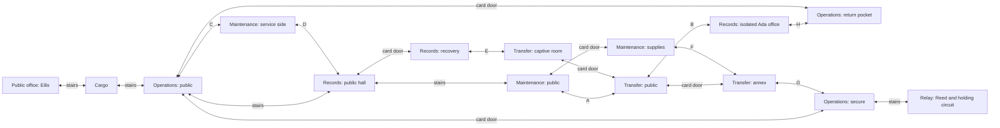

# ICE headquarters: cross-floor revision

This is a versioned chapter and verification record. Its commands, parties,
page counts and results apply to the packs named below. For current narrative,
character roles and completion actions, read [STORY.md](../STORY.md),
[PROGRESSION.md](../PROGRESSION.md) and the
[current composition record](../revisions/current-story-v01/README.md).
Use the current composition path for new publications. Later source changes
need their own pack verification. Historical fixtures do not establish an
uninterrupted ordinary-party campaign.

## Historical chapter record

The two-floor v5 chapter was a winding, mostly linear switch sequence. It did
not meet the user's Gen 1 Silph Co. reference. This successor changes the
navigation graph, not just the number of steps or floors.

## Reference study

The original Red/Blue Silph source was read directly:
[3F](https://github.com/pret/pokered/blob/master/data/maps/objects/SilphCo3F.asm),
[5F](https://github.com/pret/pokered/blob/master/data/maps/objects/SilphCo5F.asm),
[7F](https://github.com/pret/pokered/blob/master/data/maps/objects/SilphCo7F.asm),
[11F](https://github.com/pret/pokered/blob/master/data/maps/objects/SilphCo11F.asm),
and the [5F persistent doors](https://github.com/pret/pokered/blob/master/scripts/SilphCo5F.asm).
The annotated original-game
[7F floor plan](https://livedoor.blogimg.jp/tono1985/imgs/f/0/f0c87431.jpg)
was also viewed. No disassembly, ROM or source graphics were added to the repo.

The useful precedent is disconnected sections within the same floor, reached
through other floors; a credential that changes previously explored routes;
optional recovery/rewards; and a rival confrontation on the approach to the
final office. This is not an eleven-floor reproduction of Silph Co.

## Implemented source

The authoritative [network](../lairs/ice-headquarters/network.json) pairs actual
active tiles and safe arrivals. Four explicit floor files define native art
and collision. Rust adds them to the frozen drilling parent before the final
Minnesota-only binding. Generated packs remain ignored.

There are six dungeon floors plus the existing public office:

| Floor | Distinct navigation/job |
| --- | --- |
| Cargo | Existing breaker, Uma and opened service stair/return |
| Operations | Public and secure halves; a separate return pocket; relay access |
| Records | Public stair hall, isolated Ada room, locked recovery room |
| Maintenance | Bent public corridor, locked workshop, isolated service side |
| Transfer | Public loading section, captive room, separate transfer annex |
| Relay | Existing Reed battle and independently operated holding circuit |

Eight **bidirectional panel pairs** and four stair connections join these
sections. Six individually opened card doors persist through Continue.

The pre-card route can follow public stairs, explore the C/D service loop,
and reach the card only by taking A into Transfer and B into Ada's isolated
Records room. Stairs alone cannot reach her. Ada kept a card because ICE made
her sort detainee names without charges. She offers it in a spoken conversation;
declining or having no bag space leaves the offer retryable.

H returns the player to a sealed pocket on the earlier Operations floor.
Using the card there opens a newly useful return. Other card doors unlock
Nora's optional recovery room, Tess's detention room, Ollie's supplies and
alternate approaches through Maintenance/Transfer to the secure Operations
section. The player can approach the relay through the Operations door or
the G panel. The card remains in the bag and does not automatically open
every door, defeat Reed, disable the circuit or release Ellis.



This diagram shows actual connections. Each node names a connected section,
so multiple nodes on one floor deliberately remain separate before the card.
Opened shutters become ordinary floor. Only actual transfer plates use the
distinct blue metal pattern, with an upper-right native warp tile.

Four additional guards use native trainer sight and actual battles. The
existing parasite/slush/Cindore/Cartick identity, Wrigglet-line bosses and
Minnesota-only species policy are retained.

## Native implementation boundaries

All gameplay runs through `VisibleShellController`. Transfer tiles have real
`WARP_PANEL` collision in a local native-art variant; original facility
collision and every original runtime file remain unchanged. Door restoration
uses native entry/Continue callbacks. No custom frontend dispatcher is added.

The graph preview proves that the card is unreachable by stairs alone, the
relay is sealed before credentials, the three optional rooms open afterward,
and reachable panel compartments have returns. Those checks are source/data
proof, not native playability acceptance. Versioned complete-floor previews
remain in `renders/story-events-v2/ice-headquarters-*`.

## Acceptance

The final 563-map `minnesota-northstar-complex-story-v5.crystalpack` runtime-verified.
The full native course passed with the final floor/pad distinction: all eight
panel pairs, all six doors, native sight encounters, card refusal/retry and
repeat handling, optional recovery/supplies/captive, actual Reed/enforcer
battles, separate holding shutdown, return and Ellis release. Completed-scene
Save/Continue is exercised repeatedly; no state is written after the declared
fixture. Safe arrivals remain ordinary floor and do not act as extra pads.

The compiled graph audit checks every stair/pad record's destination and
landing against the source, not just abstract floor adjacency. It proves
that stairs alone cannot reach Ada, the relay stays sealed before the card,
optional rooms become reachable, and every reached arrival can get back.

The strict preservation test passed against the immutable drilling parent:
every original runtime file, tileset, trainer, unrelated map and executable
program is preserved. Only the two existing floor event-wire sections change
warp destinations. New runtime files are confined to the local native panel
art. Audio programs/manifests and recovery destinations remain unchanged.
Both final-parent regional binding/preservation tests also passed.

The actual production stdio replay passed Ada refusal/retry, the card grant,
repeat dialogue and Start, with clean exit and byte-empty stderr. Five other
native story regressions passed on the v4 candidate: opening/egg/loss, Mina,
and the complete Iron Range course. The v5 revision changes opened-door floor
art only; those maps and their scripts remain untouched by this overlay.

Whole-floor source previews were visually reviewed and revised to remove
repeated partitions. Native 2D/2.5D captures at the same position, facing and
noon were reviewed for Ada's isolated office and the returned Operations
pocket. The v4 return image exposed an ambiguity between opened doors and
pads; v5 fixes it with ordinary doorway floor. All versions remain archived.

- [Complete source floor plans](../renders/story-events-v2/ice-headquarters-1793154497269928000/whole-complex.png)
- [Final native returned-pocket comparison](../renders/story-events-v2/native-hq-v5/return-pocket-compare.png)
- [Final native Ada office comparison](../renders/story-events-v2/native-hq-v5/ada-office-compare.png)

Scoped Rust formatting and both-crate/all-target Clippy checks passed with
the location-tester feature and existing baseline lint allowances
(`never_loop`, `bad_bit_mask`, `approx_constant`, `useless_conversion`).
Unrelated existing warnings remain. Full workspace formatting still fails on
pre-existing `offset-allocator` formatting starting at `src/lib.rs:408`.
A one-line `MovementMode::Walking` to `Normal` correction in the concurrently
authored Moorhead test was required to compile the shared test target.
The Iron Range remains the simpler industrial maze; this larger cross-floor
redesign applies to ICE headquarters.

## Local publication and replay

The Rust publishers were built using the pinned toolchain and
`CARGO_TARGET_DIR=target/northstar-story`, `CARGO_PROFILE_WASM_DEV_OPT_LEVEL=0`,
`RUST_MIN_STACK=67108864`, profile `wasm-dev`. These publication commands ran:

```sh
RUST_MIN_STACK=67108864 target/northstar-story/wasm-dev/pack_northstar_ice_headquarters \
  content-packs/minnesota-northstar-drill-lair-v4.crystalpack \
  planning/minnesota/lairs/ice-headquarters \
  content-packs/minnesota-northstar-ice-headquarters-v5.crystalpack
RUST_MIN_STACK=67108864 target/northstar-story/wasm-dev/pack_northstar_regional_cast \
  content-packs/minnesota-northstar-ice-headquarters-v5.crystalpack \
  planning/minnesota/story-pokemon.json \
  planning/minnesota/pokemon/roster.json \
  planning/minnesota/pokemon/roster-curation.json \
  planning/minnesota/pokemon/species-profiles.json \
  content-packs/minnesota-northstar-complex-story-v5.crystalpack
```

The final pack runtime-verified with 563 maps and SHA-256
`2c97325b2491e875dc89c73d7da06c75fc9649c37d3abcce7acd7b2a9ef16581`.
The original drilling parent, earlier character-story pack, and all their saves
retain their identities. No save migration or replacement of shared core packs
was performed.

The production stdio replay uses an actual card-declined chapter checkpoint:

```sh
RUST_MIN_STACK=67108864 .local/minnesota-review-env/bin/python \
  planning/minnesota/tools/check_ice_headquarters_mcp.py \
  --client target/northstar-story/wasm-dev/geothite \
  --pack content-packs/minnesota-northstar-complex-story-v5.crystalpack \
  --save .local/northstar-hq-native-v5-saves/ice-hq-card-declined.crystalsave
```

Verification saves and packs are ignored local outputs, not shipped source.
The native course starts with explicitly supplied prior cargo/recruitment and
two badges, plus regional partners at levels 45/43/42/42 and four Super Potions.
It proves navigation, actual battles, controls and persistence. It does not
prove intended-level balance of the extended gauntlet or a new uninterrupted
Hall of Fame journey. The unchanged enforcer's earlier level-22/23 comparison
is recorded separately in the character-story runbook.

## Later intended-level acceptance

The combined [Iron Range workings successor](iron-workings.md) is published in
`minnesota-northstar-complex-story-v6.crystalpack`. Its complete native ICE
public-office-to-Ellis course passed for Slipperina, Rimepelt and Portabeau at
23, each with Gillpup/Cindore/Notchbill at 22, average DVs and four starting
Super Potions. Recruitment and cargo power are earned in each run. No HP, PP,
RNG, party, position or result writes occur after the initial party/two-badge
fixture. The route uses Nora before Reed and returns for recovery before the
enforcer; Ollie's two potions are received once through his actual dialogue.
Normal XP gains are retained. Optional trainers are avoidable; this checks the
main route, not clearing every trainer. This supersedes the earlier v5
intended-level limitation while preserving its historical geometry evidence.
