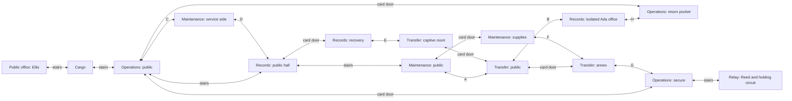

# ICE headquarters: cross-floor revision

The two-floor v5 chapter was a winding, mostly linear switch sequence. It did
not meet the user's Gen 1 Silph Co. reference. This successor changes the
navigation graph, not just the number of steps or floors.

## Reference study

The original Red/Blue Silph source was read directly:
[3F](https://github.com/pret/pokered/blob/master/data/maps/objects/SilphCo3F.asm),
[5F](https://github.com/pret/pokered/blob/master/data/maps/objects/SilphCo5F.asm),
[7F](https://github.com/pret/pokered/blob/master/data/maps/objects/SilphCo7F.asm),
[11F](https://github.com/pret/pokered/blob/master/data/maps/objects/SilphCo11F.asm),
and the [5F persistent doors](https://github.com/pret/pokered/blob/master/scripts/SilphCo5F.asm).
The annotated original-game
[7F floor plan](https://livedoor.blogimg.jp/tono1985/imgs/f/0/f0c87431.jpg)
was also viewed. No disassembly, ROM or source graphics were added to the repo.

The useful precedent is disconnected sections within the same floor, reached
through other floors; a credential that changes previously explored routes;
optional recovery/rewards; and a rival confrontation on the approach to the
final office. This is not an eleven-floor reproduction of Silph Co.

## Implemented source

The authoritative [network](../lairs/ice-headquarters/network.json) pairs actual
active tiles and safe arrivals. Four explicit floor files define native art
and collision. Rust adds them to the frozen drilling parent before the final
Minnesota-only binding. Generated packs remain ignored.

There are six dungeon floors plus the existing public office:

| Floor | Distinct navigation/job |
| --- | --- |
| Cargo | Existing breaker, Uma and opened service stair/return |
| Operations | Public and secure halves; a separate return pocket; relay access |
| Records | Public stair hall, isolated Ada room, locked recovery room |
| Maintenance | Bent public corridor, locked workshop, isolated service side |
| Transfer | Public loading section, captive room, separate transfer annex |
| Relay | Existing Reed battle and independently operated holding circuit |

Eight **bidirectional panel pairs** and four stair connections join these
sections. Six individually opened card doors persist through Continue.

The pre-card route can follow public stairs, explore the C/D service loop,
and reach the card only by taking A into Transfer and B into Ada's isolated
Records room. Stairs alone cannot reach her. Ada kept a card because ICE made
her sort detainee names without charges. She offers it in a spoken conversation;
declining or having no bag space leaves the offer retryable.

H returns the player to a sealed pocket on the earlier Operations floor.
Using the card there opens a newly useful return. Other card doors unlock
Nora's optional recovery room, Tess's detention room, Ollie's supplies and
alternate approaches through Maintenance/Transfer to the secure Operations
section. The player can approach the relay through the Operations door or
the G panel. The card remains in the bag and does not automatically open
every door, defeat Reed, disable the circuit or release Ellis.



This diagram shows actual connections. Each node names a connected section,
so multiple nodes on one floor deliberately remain separate before the card.
Opened shutters become ordinary floor. Only actual transfer plates use the
distinct blue metal pattern, with an upper-right native warp tile.

Four additional guards use native trainer sight and actual battles. The
existing parasite/slush/Cindore/Cartick identity, Wrigglet-line bosses and
Minnesota-only species policy are retained.

## Native implementation boundaries

All gameplay runs through `VisibleShellController`. Transfer tiles have real
`WARP_PANEL` collision in a local native-art variant; original facility
collision and every original runtime file remain unchanged. Door restoration
uses native entry/Continue callbacks. No custom frontend dispatcher is added.

The graph preview proves that the card is unreachable by stairs alone, the
relay is sealed before credentials, the three optional rooms open afterward,
and reachable panel compartments have returns. Those checks are source/data
proof, not native playability acceptance. Versioned complete-floor previews
remain in `renders/story-events-v2/ice-headquarters-*`.

## Acceptance

Publication, native traversal, strict preservation, stdio and scene review
are in progress. The earlier v5 test record remains attached to its original
pack. It does not establish this successor's acceptance.

## Local publication and replay

The Rust publishers were built using the pinned toolchain and
`CARGO_TARGET_DIR=target/northstar-story`, `CARGO_PROFILE_WASM_DEV_OPT_LEVEL=0`,
`RUST_MIN_STACK=67108864`, profile `wasm-dev`. These publication commands ran:

```sh
RUST_MIN_STACK=67108864 target/northstar-story/wasm-dev/pack_northstar_ice_headquarters \
  content-packs/minnesota-northstar-drill-lair-v4.crystalpack \
  planning/minnesota/lairs/ice-headquarters \
  content-packs/minnesota-northstar-ice-headquarters-v5.crystalpack
RUST_MIN_STACK=67108864 target/northstar-story/wasm-dev/pack_northstar_regional_cast \
  content-packs/minnesota-northstar-ice-headquarters-v5.crystalpack \
  planning/minnesota/story-pokemon.json \
  planning/minnesota/pokemon/roster.json \
  planning/minnesota/pokemon/roster-curation.json \
  planning/minnesota/pokemon/species-profiles.json \
  content-packs/minnesota-northstar-complex-story-v5.crystalpack
```

The final pack runtime-verified with 563 maps and SHA-256
`2c97325b2491e875dc89c73d7da06c75fc9649c37d3abcce7acd7b2a9ef16581`.
The original drilling parent, earlier character-story pack, and all their saves
retain their identities. No save migration or replacement of shared core packs
was performed.

The production stdio replay uses an actual card-declined chapter checkpoint:

```sh
RUST_MIN_STACK=67108864 .local/minnesota-review-env/bin/python \
  planning/minnesota/tools/check_ice_headquarters_mcp.py \
  --client target/northstar-story/wasm-dev/geothite \
  --pack content-packs/minnesota-northstar-complex-story-v5.crystalpack \
  --save .local/northstar-hq-native-v5-saves/ice-hq-card-declined.crystalsave
```

Verification saves and packs are ignored local outputs, not shipped source.
The native course starts with explicitly supplied prior cargo/recruitment and
two badges, plus regional partners at levels 45/43/42/42 and four Super Potions.
It proves navigation, actual battles, controls and persistence. It does not
prove intended-level balance of the extended gauntlet or a new uninterrupted
Hall of Fame journey. The unchanged enforcer's earlier level-22/23 comparison
is recorded separately in the character-story runbook.
