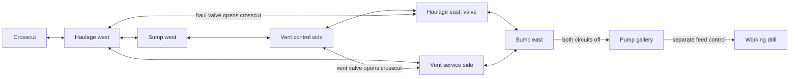

# Iron Range: interleaved workings

This is a versioned chapter and verification record. Its commands, parties,
page counts and results apply to the packs named below. For current narrative,
character roles and completion actions, read [STORY.md](../STORY.md),
[PROGRESSION.md](../PROGRESSION.md) and the
[current composition record](../revisions/current-story-v01/README.md).
Use the current composition path for new publications. Later source changes
need their own pack verification. Historical fixtures do not establish an
uninterrupted ordinary-party campaign.

## Historical chapter record

The original three-room crosscut/gallery/core chapter was too linear for the
requested substantial villain lair. This revision inserts three hand-authored
levels ahead of the pump gallery. ICE keeps its distinct card-and-transfer-pad
navigation; the mine uses ladders between separate sides of industrial shafts.

## Authored navigation

The [network](../lairs/iron-workings/network.json) is authoritative. It defines
eight reciprocal ladder pairs, two independent pressure controls and a sump
shutter requiring both controls. Layout rows use original native underground
and facility art; no source graphics or audio are replaced.

| Level | Navigation and purpose |
| --- | --- |
| Public mine | Existing Nell request, prerequisite-gated foreman battle and lower shaft |
| Crosscut | Existing irregular cave approach |
| Haulage | Separate west loading and east drive passages; service-loop choice; haulage valve opens the connecting crosscut |
| Sump | Separate west sump access and stepped east pump approach; both live circuits hold the upper shutter |
| Ventilation | Separate control and service sides, native machinery banks; vent valve opens the local crosscut |
| Pump gallery | Existing separate feed-isolation action opens core access and a return shortcut |
| Drill core | Witnessed moving piston, Reed battle, separate drive stop, Finn's appearance and separately accepted meter quest |



The service ladders let the player encounter the locked pump approach before
either valve and enter the far side of previously explored levels. The valves
can be reached independently; this is not a forced first-switch/second-switch
corridor. Each control gives a shorter route on its own level. Both are needed
at the sump. Neither awards the existing feed, drill, rival, rescue or meter
result. Ruth and Vern explain the situation in spoken conversations.

The return uses the new crosscuts rather than repeating the first ladder
sequence. All arrivals are ordinary floor before entry callbacks. The original
public and core port indices remain stable; only the former crosscut/gallery
connection is replaced. No new Fly or blackout destination is introduced.

## Local publication

Generated packs are ignored. The frozen headquarters parent and old chapter
packs remain unchanged; their saves are not migrated.

```sh
CARGO_TARGET_DIR=target/northstar-story CARGO_PROFILE_WASM_DEV_OPT_LEVEL=0 \
  RUST_MIN_STACK=67108864 cargo build --locked --profile wasm-dev \
  -p crystal-assets --bin pack_northstar_iron_workings
RUST_MIN_STACK=67108864 target/northstar-story/wasm-dev/pack_northstar_iron_workings \
  content-packs/minnesota-northstar-ice-headquarters-v5.crystalpack \
  planning/minnesota/lairs/iron-workings \
  content-packs/minnesota-northstar-iron-workings-v3.crystalpack
RUST_MIN_STACK=67108864 target/northstar-story/wasm-dev/pack_northstar_regional_cast \
  content-packs/minnesota-northstar-iron-workings-v3.crystalpack \
  planning/minnesota/story-pokemon.json \
  planning/minnesota/pokemon/roster.json \
  planning/minnesota/pokemon/roster-curation.json \
  planning/minnesota/pokemon/species-profiles.json \
  content-packs/minnesota-northstar-complex-story-v6.crystalpack
```

The resulting regional pack runtime-verifies with **566 maps and 474 installed
species records**. The regional binder audits Minnesota appearances against
the active Minnesota roster; the installed count includes unchanged source
regions and is not a claim of 474 Minnesota species.

Read-only topology/source-art review:

```sh
.local/minnesota-review-env/bin/python planning/minnesota/tools/review_iron_workings.py \
  content-packs/minnesota-northstar-complex-story-v6.crystalpack
```

## Acceptance evidence

The first whole-map pass looked too much like repeated warehouse rooms. The
ventilation level was changed to native facility machinery and an irregular
outline. A stateful collision check also caught a half-wall bypass around the
sump shutter; its edge was closed and all four circuit states rechecked.
Every safe arrival and return is audited. Source previews and rejected versions
remain archived.

The native mine course extends the existing foreman-to-Finn test through all
eight ladder pairs. It checks refusal/retry, one-circuit denial, each local
crosscut, both-circuit entry and Continue, then the original actual rival
battle, witnessed piston frames, drive shutdown, Finn quest and full return.
Its party remains an explicit level-44–48 geometry fixture. It does not prove
normal-level mine balance or an earned campaign.

The separate ICE intended-level course uses each starter's second stage at
23 plus Gillpup, Cindore and Notchbill at 22, average DVs, zero initial stat
experience and four Super Potions. It follows real menus, battles, gains and
resources. Nora's unlocked recovery room is used before Reed and revisited
before the enforcer. Ollie supplies two potions once. No HP, PP, RNG, party,
position or event writes occur after setup. A headquarters-only run passed all
three variants; the public-office recruitment/cargo extension also passed, as
recorded below. Optional guards can be avoided; this is a main
route balance check, not a requirement to defeat every optional trainer.

## Verified combined candidate

`minnesota-northstar-complex-story-v6.crystalpack` SHA-256:
`a24a09b500a0c1463b60dde1f8586f199cf9628dee0a4f4bba5fb5c9c629545a`.

Passed on this candidate:

- Complete expanded native mine course, including actual foreman and Reed wins,
  both opposite held piston strokes, separate shutdown, Finn quest and return.
- Complete public-office-to-Ellis ICE course with all three intended-level
  starter parties: **215.64 seconds**, no state edits after setup. Recruitment
  and cargo power are earned within each run, rather than fixture flags.
  Grass and Fire runs take substantial losses; Water is the favorable matchup.
- Mine overlay preservation/malformed-source regression: all original runtime
  files, audio, trainers, recovery points and unrelated maps remain identical.
  The two original connection sections retain all non-warp rows.
- Both regional-cast policy/preservation tests using the final unbound mine
  parent, covering Minnesota appearances and source-region/audio preservation.
- Production stdio pressure refusal/retry, valve action, repeat dialogue and
  Start, with clean exit and byte-empty stderr.
- Stateful compiled connection audit: eight reciprocal ladder pairs, both
  circuits required, reachable independent controls, safe arrivals and returns.
- Assets and Bevy all-target Clippy with `location-tester` and the established
  baseline allowances; no warnings in the new modules. Existing unrelated
  warnings remain. Scoped Rust formatting passes. Full workspace formatting
  still fails at the pre-existing `offset-allocator/src/lib.rs:408` difference.

Reviewed artifacts (all originals/versions retained):

- [Whole workings source plans](../renders/story-events-v2/iron-workings-1793180970020852000/whole-complex.png)
- [Native ventilation comparison](../renders/story-events-v2/native-iron-v6/vent-crosscut-compare.png)
- [Native east sump arrival comparison](../renders/story-events-v2/native-iron-v6/sump-shutter-compare.png)
- [Native opened sump gate comparison](../renders/story-events-v2/native-iron-v6-final/sump-gate-compare.png)

These images verify authored scenery and navigation readability. They do not
claim acceptance of all creature 3D models or an earned full-game playthrough.

Replay with the current Bevy unit-test executable:

```sh
export CARGO_TARGET_DIR=target/northstar-story
export CARGO_PROFILE_WASM_DEV_OPT_LEVEL=0
export RUST_MIN_STACK=67108864
cargo test --locked --profile wasm-dev -p crystal-bevy \
  --features location-tester --lib --no-run
export CRYSTAL_WINONA_TEST_PACK="$PWD/content-packs/minnesota-northstar-complex-story-v6.crystalpack"
export CRYSTAL_NORTHSTAR_EVENTS_SAVE_DIR="$PWD/.local/northstar-workings-replay-saves"
export RUST_MIN_STACK=67108864
# Use the executable path printed by Cargo; hashes depend on feature unification.
target/northstar-story/wasm-dev/deps/crystal_bevy-6eaab16705efea6f \
  drill_lair_native_maze_witnessed_piston_rival_shutdown_crew_quest_and_continue \
  --ignored --nocapture
target/northstar-story/wasm-dev/deps/crystal_bevy-6eaab16705efea6f \
  ice_headquarters_intended_level_three_starters_complete_the_gauntlet \
  --ignored --nocapture
.local/minnesota-review-env/bin/python planning/minnesota/tools/check_iron_workings_mcp.py \
  --client target/northstar-story/wasm-dev/geothite \
  --pack "$CRYSTAL_WINONA_TEST_PACK" \
  --save "$CRYSTAL_NORTHSTAR_EVENTS_SAVE_DIR/ice-iron-pressure-declined.crystalsave"
```
